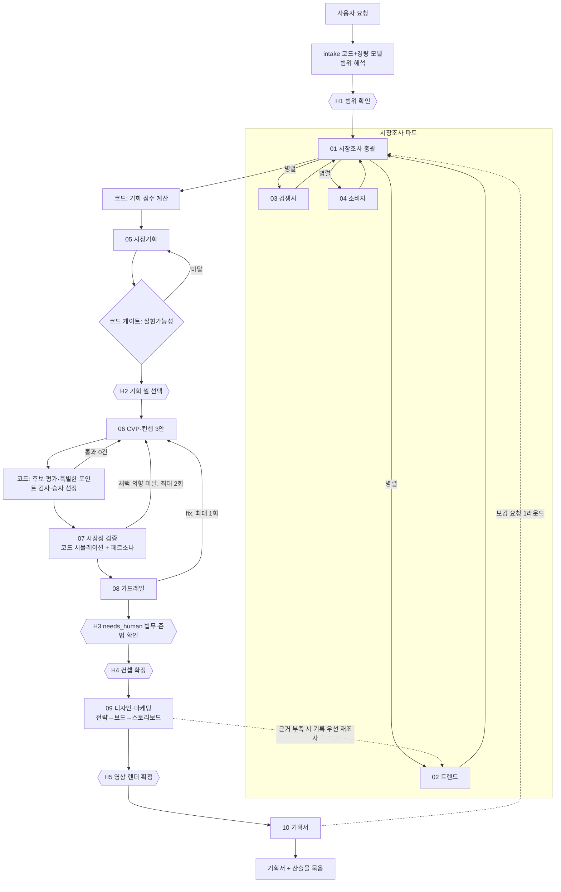

# 서비스 개요와 아키텍처

## 1. 서비스 정의

카드사 상품기획 담당자가 한 줄 요청("2030 투자 입문자를 위한 새로운 신용카드를 기획해줘")을 넣으면, 에이전트 팀이 시장조사부터 기획서까지 이어서 만들고, 사람은 정해진 다섯 곳에서 확인·선택·승인한다. 모든 산출물은 출처와 가정이 붙은 JSON으로 남고, 화면과 기획서는 그 JSON을 보여 주는 보기다.

### 세 가지 이용 방식(서비스 모드)

| 모드 | 사용자가 하는 일 | 부르는 것 | 근거 |
|---|---|---|---|
| ① 개별 에이전트 | 에이전트 하나를 골라 여러 턴 대화 | 해당 에이전트 단독(`mode=standalone`). 앞 단계 결과가 필요하면 기록(Ledger)에서 찾고, 없으면 앞 단계를 자동 선행 | C의 단독 대화, D의 "앞 단계 자동 선행", A 기능 정의 F-01 |
| ② 시장조사 | 시장 질문을 대화로 이어 가며 조사 | 시장조사 총괄 + 트렌드·경쟁사·소비자 | C 전체, A F-02 |
| ③ E2E 상품기획 | 요청 한 줄 → 기획서 | 오케스트레이터가 10개 에이전트와 코드 단계를 순서대로 | A 리허설, D 파이프라인, A F-03 |

단독 대화에서 영역 밖 질문이 나오면 에이전트가 해당 영역을 알려 주고, 대화 요약(`conversation.summary`)을 붙여 ② 또는 ③으로 넘길지 제안한다(C 4-4).

## 2. 구성도

모든 에이전트 호출은 하네스를 지난다: ① 예산 확인 → ② LLM 호출 → ③ 스키마 검증 → ④ 출처 검증(근거 ⊂ 출처 목록, 발행일) → ⑤ 금칙어·준법 표현 → ⑥ 반려 시 사유 코드를 넣어 1회 재요청(A 허브 구조도). 통과한 출력만 다음 단계로 간다.

## 3. 에이전트와 코드 단계 목록

| 단계 | 이름 | 종류 | 입력(핵심) | 출력(핵심) | 다음 |
|---|---|---|---|---|---|
| S0 | intake | 코드 + 경량 LLM | 요청문, 기준일 | `scope`(타깃 세그먼트, 카드 유형, 목표 채택률, 제약, 가정) | H1 |
| S1 | 01 research_lead | LLM | scope, 대화 맥락 | 종합 결론, 영역별 근거, 충돌, 불확실, 3개 에이전트 원 응답 | S2 |
| S1a | 02 trend | LLM + 웹 검색 | 질문, 기준일 | 시그널 배열(id, topic, strength, reliability, impl, sources) | 04, 05, 09, 10 |
| S1b | 03 competitor | LLM + 카드 조회 | 질문, 허용 태그, 경쟁 카드 DB | crowded, empty, nearest, products | 05, 06 |
| S1c | 04 consumer | LLM + 공개 웹 | 질문, 세그먼트 팩, 시그널 | top_needs, must_have, can_give_up, 반응 경향 | 05, 06 |
| S2 | 기회 점수 | 코드 | 세그먼트 팩, 시장조사 결과 | 세그먼트×니즈 셀 점수 상위 12 | S3 |
| S3 | 05 whitespace | LLM | 시장조사 3종, 셀 점수 | picks 상위 3 | 게이트, H2 |
| S3g | 실현가능성 게이트 | 코드 | picks, 세그먼트 팩 | 셀별 채택 천장 ≥ 목표 여부 | H2 |
| S4 | 06 concept | LLM | 선택 셀, 공백·혼잡, 니즈 | 컨셉 3안 | S4e |
| S4e | 후보 평가·승자 | 코드 | 3안, 경쟁 DB | 안별 지표, 통과 여부, `winner` | S5 |
| S5 | 07 validation | 코드 + LLM | winner | `twin`(채택 의향, 유형별 손익, 시나리오), 페르소나 4유형 반응 | 게이트 |
| S6 | 08 guardrail | LLM | winner, twin | checks(pass/needs_human/fix), 이름·작동 일치 | H3, H4 |
| S7 | 09 design_marketing | LLM + 검수 코드 + 렌더 | 확정 카드 브리프, 가드레일 미결, 시그널 | strategy, boards, storyboards, 이름 후보 | H5 |
| S8 | 10 plan_doc | LLM + 수치 대조 코드 | 전 단계 JSON, 고객 틀 | markdown 기획서, 사용 출처, 미검증 항목 | 끝 |

## 4. 게이트와 기준값

모든 기준값은 PM 가정치(A `live/h.js`)이며, 고객 재무·상품 부서 기준을 받으면 교체한다(PM 문서 Q4).

| 게이트 | 위치 | 기준 | 미달 시 |
|---|---|---|---|
| 실현가능성 | S3 뒤 | 셀의 채택 천장 ≥ 목표 채택률(기본 0.38) | 해당 셀을 빼고 다음 순위 셀로. 모두 미달이면 H1로 돌아가 범위 재확인 |
| 후보 통과 | S4e | 정적 손익 ≥ 3(만원/인/년), 최근접 경쟁 카드 유사도 ≤ 0.5, 복잡도 ≤ 0.5, 특별한 포인트 유효, 금칙어 0, 혜택률 0 초과 3% 이하 | 통과 0건이면 컨셉 재작업(사유 코드 전달). 재작업 2회째부터 상위 모델 |
| 채택 의향 | S5 뒤 | 타깃 채택 의향 ≥ 0.38, 채택 고객 손익 ≥ 1.5 | 컨셉 재작업 최대 2회. 그래도 미달이면 S3로 돌아가 다른 셀(상위 재선택), 가장 좋았던 시도를 보존 |
| 가드레일 | S6 뒤 | fix 0건 | fix가 있으면 수정안을 넣어 컨셉 재작업 최대 1회. needs_human은 진행하되 H3에서 담당자 지정 |
| 디자인 검수 | S7 안 | E qa.py 규칙 + 금융 규칙(02 문서 5절) | 1회 재생성, 다시 실패하면 사람에게 |
| 기획서 검증 | S8 뒤 | 섹션 순서, 입력에 없는 수치·URL 0건, 필수 표기 | 1회 재작업(사유 코드), 다시 실패하면 사람에게 |

## 5. 사람 확인 지점(H1~H5)

| 지점 | 화면에서 보이는 것 | 사람이 하는 일 | 답이 없을 때 |
|---|---|---|---|
| H1 범위 확인 | 해석한 타깃·카드 유형·목표·가정 | 확인 또는 수정 | 30분 뒤 기본 해석으로 진행하고 가정으로 기록(A 고객 접점 원칙) |
| H2 기회 셀 선택 | 상위 3셀, 근거, 실현가능성 | 1개 선택(여러 개 선택 시 셀마다 컨셉 실행) | 1순위 셀로 진행 |
| H3 가드레일 사람 확인 | needs_human 항목과 확인 부서 | 담당자 지정, 의뢰 여부 표시 | 진행은 하되 기획서 리스크·부록에 "미확인"으로 고정 |
| H4 컨셉 확정 | 승자 카드, 지표, 페르소나 반응, 가드레일 결과, 탈락 후보 | 확정 / 재작업 요청(사유 입력) | 대기(진행하지 않음) |
| H5 영상 렌더 확정 | 스토리보드 실시간 미리보기 | "이대로 확정" | 렌더하지 않음. 기획서 6절은 스토리보드로 작성 |

## 6. 회수(되돌림) 규칙

- 재호출 전에 기록 원장(Ledger)을 먼저 조회한다. 같은 입력의 산출물이 있으면 다시 부르지 않는다(A trace: 홍보 주제에서 경쟁·소비자 결과 재사용).
- 허용된 회귀 경로만 쓴다: validation→concept, guardrail→concept, validation 반복 실패→whitespace, design_marketing→trend(needs_research가 있을 때, 주제 3개 이하), plan_doc→research_lead·whitespace·concept(보강 요청, D 결정 27).
- 상한: 한 실행 전체 회귀 8회, 에이전트별 검증 반려 재시도 1회, 컨셉 재작업 합계 3회, 시장조사 총괄 호출 7회·판단 5회·약 240초, 기획서 보강 요청 1라운드 3건.
- 상한에 걸리면 멈추지 않고 가장 좋은 시도로 진행하며, 미달 사실을 기획서 리스크와 개발 뷰에 남긴다.

## 7. 기록과 화면

- 모든 단계는 이벤트(`run_start`, `route`, `call`, `result`, `validate`, `reject`, `rework`, `gate`, `human_wait`, `human_decision`, `run_end`)를 trace에 남긴다. 사용자 뷰와 개발 뷰는 같은 trace를 다르게 보여 준다(A 재생 뷰어 구조).
- 사용자 뷰는 단계 카드, 결과 요약, 사람 확인 버튼, 기획서를 보여 준다. 내부 필드명(segId, no_cap 등)은 화면과 기획서에 노출하지 않는다(A 실험 5절의 교훈).
- 개발 뷰는 그래프, 에이전트 레지스트리, 호출별 입출력, 검증 결과, 토큰·시간, 회수 이력을 보여 준다.

## 8. 기술 구성(MVP 기준)

| 층 | 로컬 개발 | AWS 이관 | 근거 |
|---|---|---|---|
| 오케스트레이션 | Python + LangGraph 상태 그래프, 노드 단위 체크포인트, interrupt로 사람 대기 | Step Functions(순서·회수·대기) | D 결정 01·08, A AWS 구조도 |
| 에이전트 실행 | 에이전트별 모듈, 공식 Anthropic SDK 구조화 출력 | AgentCore Runtime 또는 Lambda, Bedrock Converse + toolConfig | C llm.py, E agent_handler.py |
| 검증기 | Python 함수(스키마, 출처, 수치, 금칙어, 게이트) | Lambda 검증기 | A h.js·vmkt.js, E qa.py |
| 도구 | 웹 검색(Claude 서버 도구 또는 Tavily), 카드 정보 조회, 검색 캐시 7일 | AgentCore Gateway 뒤 도구, Knowledge Bases | C tools/, A aws 탭 |
| 저장 | SQLite(대화·조회 기록), 파일(JSON 산출물, trace) | DynamoDB(실행·대화·버전), S3(산출물·원문·영상) | C store.py, E 설계서 |
| 화면 | 정적 HTML + SSE | Amplify 또는 S3+CloudFront, API Gateway WebSocket, Cognito | E 설계서, A AWS 구조도 |
| 영상 | 브라우저 실시간 미리보기 | 확정 후 Remotion Lambda 렌더 → S3 서명 URL | E |
