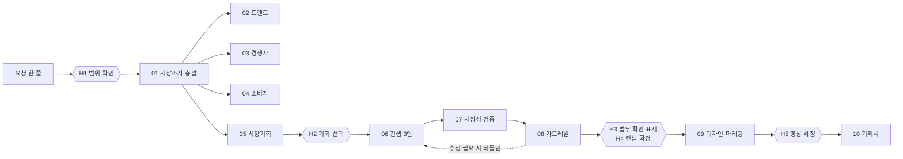

# 카드 신상품 기획 AI 에이전트 설계서 (고객 검토용)

## 0. 문서 정보

| 항목 | 내용 |
|---|---|
| 버전 | v0.9 (1차 데모 전 검토본) |
| 대상 | 금융혁신실, 상품개발부, AX기획부, AX개발부 |
| 목적 | 개발 중인 에이전트 10개와 오케스트레이터의 역할·작동 방식·한계를 공유하고, 개발 방향을 1차 확정할 피드백을 받는다 |
| 피드백 방법 | 4장 "피드백 요청 모음" 표의 "고객 의견" 칸을 채워 회신. 장별 의견은 자유 형식으로 추가 |
| 피드백 기한 | [회신 기한: 1차 데모 피드백 워크숍 전] |
| 개발 문서 연결 | 에이전트별 개발 설계서 `agents/<폴더>/설계서.md`, 실행 샘플 `samples/<폴더>/` |

숫자 표기 원칙: "리허설 기준"은 2026-10-16~17 리허설 실행 기록의 값이다. "가정치"는 고객사 기준을 받기 전에 PM이 정한 값이다. 채택 의향과 손익은 가상 고객 시뮬레이션(가정 기반)의 결과이며 실제 전환율이나 손익이 아니다.

## 1. 전체 그림

### 1-1. 서비스가 하는 일

상품기획 담당자가 "2030 투자 입문자를 위한 새로운 신용카드를 기획해줘" 같은 요청을 한 줄 넣으면, 에이전트들이 시장조사, 기회 발굴, 컨셉 설계, 시장성 검증, 재무·준법 점검, 디자인·마케팅 시안, 기획서 작성까지 이어서 수행한다. 사람은 정해진 다섯 곳에서 확인하고 고른다. 모든 결과에는 출처와 가정이 붙어 있어서, 기획서 한 줄에서 근거 자료까지 거슬러 올라갈 수 있다.

### 1-2. 에이전트 구성

| # | 에이전트 | 한 줄 역할 | 판단 주체 |
|---|---|---|---|
| 00 | E2E 오케스트레이터 | 순서, 통과 기준, 되돌림, 사람 확인 대기, 기록 | 코드 |
| 01 | 시장조사 총괄 | 질문을 나눠 02~04를 동시에 부르고, 결과를 종합하고, 충돌을 그대로 보여 줌 | AI |
| 02 | 트렌드 | 시장·규제·기술 변화 신호 4~6개와 출처 | AI + 웹 검색 |
| 03 | 경쟁사 | 시판 카드 혜택 비교, 붐비는 혜택과 빈 혜택 | AI + 카드 DB |
| 04 | 소비자 | 타깃의 니즈 우선순위와 발급 장벽 | AI + 공개 웹 |
| 05 | 시장기회 | 타깃×니즈 기회 상위 3개 선정 | 코드 점수 + AI 선택 |
| 06 | 컨셉 | 서로 다른 카드 컨셉 3안 | AI, 평가는 코드 |
| 07 | 시장성 검증 | 가상 고객 시뮬레이션과 고객 유형별 반응 | 코드 + AI |
| 08 | 가드레일 | 재무·준법 6개 항목 점검 | AI, 사전 검사는 코드 |
| 09 | 디자인·마케팅 | 이름, 마케팅 전략, 카드 시안 3개, 영상 스토리보드 | AI, 검수는 코드 |
| 10 | 기획서 | 7개 섹션 기획서 | AI, 수치 대조는 코드 |

### 1-3. 이용 방식 세 가지

이번 MVP의 핵심은 에이전트가 실제로 작동하는 것과 결과가 문서로 남는 것이다. 이용 방식은 단일 에이전트부터 멀티 에이전트 오케스트레이션까지 세 단계로 나뉜다.

| 방식 | 오케스트레이션 | 사용자가 하는 일 | 결과 문서 |
|---|---|---|---|
| ① 개별 에이전트 | 단일 에이전트 | 에이전트 하나를 골라 여러 턴 대화 | 에이전트별 리포트(HTML) |
| ② 시장조사 | 멀티 에이전트, AI가 흐름 결정 | 시장 질문을 대화로 이어 감 | 시장조사 종합 리포트 |
| ③ E2E 상품기획 | 멀티 에이전트, 코드가 흐름 결정 | 요청 한 줄, 다섯 곳에서 확인 | 카드상품 기획서(7개 섹션) + 산출물 묶음 |

②와 ③의 오케스트레이션 방식이 다르다. 시장조사는 질문마다 누구를 더 불러야 할지가 달라서 AI(시장조사 총괄)가 다음 호출을 정한다. E2E 전체 흐름은 순서와 통과 기준이 고정이라 코드가 정한다. 같은 요청에 비용과 결과가 예측 가능해야 하기 때문이다.

### 1-4. 사람이 확인하는 다섯 곳

| 지점 | 사람이 보는 것 | 사람이 하는 일 | 답이 없으면 |
|---|---|---|---|
| H1 범위 확인 | AI가 해석한 타깃, 카드 유형, 목표, 가정 | 확인 또는 수정 | 30분 뒤 기본 해석으로 진행, 가정으로 기록 |
| H2 기회 선택 | 기회 상위 3개와 근거 | 1개 선택 | 1순위로 진행 |
| H3 법무 확인 표시 | 가드레일이 사람 확인 필요로 판정한 항목 | 담당 부서 지정 | 진행하되 기획서에 "미확인"으로 고정 |
| H4 컨셉 확정 | 최종 후보 카드, 지표, 고객 반응, 점검 결과, 탈락 후보 | 확정 또는 재작업 요청 | 대기 |
| H5 영상 확정 | 영상 스토리보드 미리보기 | 렌더 승인 | 렌더하지 않고 스토리보드로 기획서 작성 |

## 2. 모든 에이전트가 지키는 원칙

| # | 원칙 | 고객 입장에서 의미 |
|---|---|---|
| P1 | AI는 내용만 만들고, 점수·손익·유사도·통과 판정은 코드가 계산한다 | 같은 입력이면 같은 숫자가 나온다. AI가 숫자를 지어낼 여지를 줄인다 |
| P2 | 출처 없는 주장은 쓰지 않는다. 근거마다 URL, 발행일, 신뢰도를 붙이고 18개월 넘은 자료는 경고한다 | 기획서 문장에서 근거 자료까지 따라갈 수 있다 |
| P3 | 결과는 구조화된 데이터(JSON)가 원본이고, 화면과 기획서는 그 데이터를 보여 주는 형식이다 | 기획서에 원본 데이터에 없는 수치나 사실이 들어가면 자동으로 걸러진다 |
| P4 | 모든 결과는 자동 검사를 거친다. 걸리면 사유를 붙여 1회 다시 쓰게 하고, 그래도 걸리면 사람에게 넘긴다 | 품질 문제가 조용히 넘어가지 않고 기록된다 |
| P5 | 되돌림에는 상한이 있다(실행 전체 8회 등). 상한에 걸리면 가장 좋은 결과로 진행하고 미달 사실을 기록한다 | 무한 반복이나 비용 폭주가 없다 |
| P6 | 광고 금칙어(최고, 무조건, 100%, 최대, 확정, 무제한)와 수익 암시 표현을 자동 검사한다 | 준법 검토 전에 1차로 걸러진다 |

## 3. 에이전트별 설계

### 00. E2E 오케스트레이터

1) 한 줄 정의: 에이전트 호출 순서를 정하고, 단계마다 통과 기준을 검사하고, 기준에 못 미치면 정해진 경로로 되돌리고, 사람 확인 지점에서 멈췄다가 이어 가고, 모든 과정을 기록한다. 내용은 만들지 않는다.

2) 현업에서 대신하는 일: 기획 과제의 진행 관리. 어느 단계가 끝났는지, 어떤 기준을 통과했는지, 왜 다시 했는지를 사람이 따로 정리하지 않아도 기록이 남는다.

3) 언제 쓰나: E2E 상품기획(③)의 최상위. 개별 에이전트 대화(①)에서는 앞 단계 결과가 필요할 때 기록에서 찾아 주는 역할만 한다.

4) 받는 것: 요청문, 기준일, 각 에이전트 결과, 사람의 결정.

5) 일하는 순서

| 단계 | 주체 | 내용 |
|---|---|---|
| ① 요청 해석 | 코드 → 필요 시 AI | 타깃, 카드 유형, 목표 채택률을 규칙으로 뽑고 못 뽑은 것만 AI로 해석 |
| ② 단계 실행 | 코드 | 01→05→06→07→08→09→10 순으로 호출 |
| ③ 통과 기준 검사 | 코드 | 아래 표의 기준 |
| ④ 되돌림 | 코드 | 허용된 경로로만, 상한 안에서 |
| ⑤ 사람 대기 | 코드 + 사람 | H1~H5 |
| ⑥ 기록 | 코드 | 호출, 결과, 검사, 반려, 되돌림, 사람 결정을 시간순으로 |

통과 기준(가정치, 고객 기준을 받으면 교체)

| 위치 | 기준 | 못 미치면 |
|---|---|---|
| 시장기회 뒤 | 기회의 최대 도달 가능 채택률 ≥ 목표(0.38) | 해당 기회를 빼고 다음 순위로 |
| 컨셉 평가 | 손익 ≥ 3(만원/인/년), 최근접 경쟁 카드 유사도 ≤ 0.5, 복잡도 ≤ 0.5, 혜택률 0~3%, 금칙어 0 | 컨셉 재작업 |
| 시장성 검증 뒤 | 타깃 채택 의향 ≥ 0.38, 채택 고객 손익 ≥ 1.5 | 컨셉 재작업 최대 2회, 그래도 미달이면 다른 기회로 |
| 가드레일 뒤 | 수정 필요 판정 0건 | 수정안을 넣어 컨셉 재작업 1회 |

6) 내놓는 것: 실행 기록(trace), 산출물 묶음(JSON, 기획서, 디자인·영상 링크). 사용자 화면과 개발 화면이 같은 기록을 다르게 보여 준다.

7) 품질 규칙: 되돌림 실행 전체 8회, 컨셉 재작업 합계 3회, 에이전트별 반려 재시도 1회. 실행 시간 15분 넘으면 경고(리허설 기준 약 9.8분).

8) 사람 확인: H1~H5 모두 이 오케스트레이터가 관리한다.

9) 하지 않는 일과 한계: 에이전트 대신 판단하지 않는다. 같은 요청이라도 실행마다 최종 컨셉이 달라질 수 있다(리허설에서 '함께쌓기 카드'와 '스몰스텝 포인트투자카드'로 갈림). 데모는 저장된 결과를 재사용해 고정한다.

10) 이렇게 설계한 이유: 전체 흐름을 AI에게 맡기면 실행마다 경로와 비용이 달라지고, 고객이 "왜 이 단계를 건너뛰었나"를 추적할 수 없다. 흐름은 코드로 고정하고, 판단이 필요한 시장조사 내부만 AI에게 맡겼다.

11) 피드백 요청

| # | 질문 | 선택지 | 우리 기본안 | 답이 없으면 |
|---|---|---|---|---|
| OR-F1 | 통과 기준값(목표 채택률 0.38, 손익 3, 채택 고객 손익 1.5)을 어떤 기준으로 바꿀까요? | ① 고객 재무 기준 제공 ② 가정치 유지 후 파일럿 데이터로 보정 | ① | 가정치 유지, 화면에 "가정치" 표기 |
| OR-F2 | 사람 확인 지점 다섯 곳이 적절한가요? | ① 그대로 ② H1·H2를 빼고 자동 진행 ③ 단계마다 확인 추가 | ① | ① |
| OR-F3 | 답이 없을 때 자동 진행(H1 30분, H2 1순위)을 허용할까요? | ① 허용 ② 항상 대기 | ① | ① |

12) 데모 장면: 스토리보드 장면 2, 6, 9.

### 01. 시장조사 총괄

1) 한 줄 정의: 시장 질문을 트렌드·경쟁사·소비자 관점으로 나눠 세 에이전트를 동시에 부르고, 결과가 올 때마다 추가 조사를 정하고, 근거별 결론과 충돌, 불확실한 점을 정리한다.

2) 현업에서 대신하는 일: 시장조사 착수 때 조사 범위를 쪼개고, 세 갈래 조사 결과를 모아 한 장으로 요약하던 일. 서로 다른 결과를 하나로 뭉개지 않고 나란히 보여 준다.

3) 언제 쓰나

| 방식 | 동작 |
|---|---|
| ① 개별 대화 | "2030 투자 입문자용 신용카드를 기획하려는데, 트렌드·경쟁·소비자 관점에서 시장 상황을 종합해줘" |
| ② 시장조사 | 대화 상대. 사용자가 "새로운 주제"라고 할 때까지 앞 대화 근거를 이어 씀 |
| ③ E2E | 시장조사 단계 전체를 맡음 |

4) 받는 것: 요청 범위, 앞 대화의 근거, 개별 에이전트 대화에서 넘어온 요약.

5) 일하는 순서

| 단계 | 주체 | 내용 |
|---|---|---|
| ① 계획 | AI | 세 에이전트에 보낼 질문을 각 관점에 맞게 다듬음. 꼭 필요할 때만 사용자에게 1개 되물음 |
| ② 동시 조사 | 코드 | 새 주제면 세 에이전트를 동시에 호출 |
| ③ 추가 조사 판단 | AI | 결과가 하나 올 때마다 추가 호출 0~2개 또는 "충분" 결정 |
| ④ 종합 | AI | 결론 → 영역별 근거 → 충돌 → 불확실 → 다음 질문 순서 |
| ⑤ 근거 확인 | 코드 | 결론과 핵심 발견이 실제 조사 결과 id를 가리키는지, 결론의 숫자가 근거에 있는지 |
| ⑥ 답 검증 | AI(경량) + 코드 | 결론 문장마다 근거가 받쳐 주는지 판정, 집계는 코드 |

6) 내놓는 것: 한 줄 결론, 핵심 발견, 기회·위험, 제언, 영역별 근거, 충돌, 불확실, 다음 질문, 문서형 리포트.

리허설 결론 예: "투자 연계는 니즈 1순위이자 시판 카드의 빈칸이지만, 증권사 연계 선례가 있어 차별화와 제휴 확보가 관건이다."

7) 품질 규칙

| 규칙 | 어기면 |
|---|---|
| 새 주제는 세 에이전트를 모두 부른다(RL-R1) | 자동 반려 |
| 결론과 핵심 발견은 실제 조사 결과를 1개 이상 가리킨다(RL-R2) | 자동 반려 |
| 충돌은 합치지 않고 입장 2개 이상으로 나란히 둔다(RL-R3) | 자동 반려 |
| 결론의 숫자는 근거에 있는 값이다(RL-R4) | 자동 반려 |
| 호출 7회, 판단 5회, 약 240초 안에 끝낸다(RL-R6) | 상한에서 멈추고 기록 |

8) 사람 확인: 없음. E2E에서는 다음 단계 H2에서 사람이 결과를 본다.

9) 한계: 답 검증도 AI가 하므로 사람이 표본을 확인해야 한다. 결과 도착 순서에 따라 추가 조사가 달라질 수 있어 데모는 순서를 고정한다.

10) 이렇게 설계한 이유: 시장조사는 질문마다 필요한 조사가 다르다. 고정 순서로 세 에이전트를 한 번씩만 부르면 "경쟁사 결과를 보니 소비자 쪽을 더 봐야 한다" 같은 판단이 빠진다. 그래서 이 단계만 AI가 흐름을 정하고, 상한으로 비용을 묶었다.

11) 피드백 요청

| # | 질문 | 선택지 | 우리 기본안 | 답이 없으면 |
|---|---|---|---|---|
| RL-F1 | 시장조사 결과에 반드시 들어가야 할 관점이 더 있나요? | ① 트렌드·경쟁·소비자 3개 유지 ② 규제를 별도 관점으로 분리 ③ 기타(의견) | ① (규제는 트렌드 안에서 별도 정리) | ① |
| RL-F2 | 결과가 엇갈릴 때 보여 주는 방식 | ① 입장을 나란히(현재) ② AI가 하나로 정리하고 반대 의견 부기 | ① | ① |
| RL-F3 | 시장조사 리포트 양식이 사내에 있나요? | ① 사내 양식 제공 ② 현재 양식 사용 | ① | ② |

12) 데모 장면: 스토리보드 장면 3, 9.

### 02. 트렌드

1) 한 줄 정의: 기준일 시점의 한국 카드·결제·소비 시장에서 기획에 의미 있는 변화 신호 4~6개를 웹에서 찾고, 출처 URL·발행일·영향 강도·출처 신뢰도·기획 시사점을 붙인다. 규제·정책 변화는 따로 정리한다.

2) 현업에서 대신하는 일: 기사·보고서·보도자료를 찾아 읽고 "그래서 우리 상품에 뭐가 중요한가"를 정리하던 일. 특정 카드사의 비공개 실적 추정은 하지 않는다.

3) 언제 쓰나: ① "2030 투자 입문자를 위한 신용카드를 기획하려는데, 지금 시장에서 눈여겨볼 트렌드가 뭐야?" / ②③ 시장조사 총괄이 부름 / 디자인·마케팅이 근거가 부족하다고 하면 해당 주제만 다시 찾음.

4) 받는 것: 타깃, 주제 힌트, 기준일. 데모 단계는 일반 웹 검색, AWS 이관 후 저장 자료 검색 추가.

5) 일하는 순서: ① AI: 검색어 최대 5개(연도·기관명 포함) → ② 코드: 검색, 발행일·자료 유형 부착, 7일 캐시 → ③ AI: 검색된 문서만 근거로 신호 작성 → ④ 코드: URL 대조, 18개월 경과 표시, 신뢰도 낮은 출처 하향, 출처 없는 숫자 제거.

6) 내놓는 것(리허설 기준)

| id | 신호 | 신뢰도 |
|---|---|---|
| T1 | 증권사 연계 주식투자 전용 PLCC 카드 등장(미래에셋 현대카드) | 0.6 |
| T2 | 소액·소수점 해외주식 거래 서비스 경쟁(미래에셋, 삼성증권, 토스증권) | 0.55 |
| T3 | 2030 겨냥 브랜드 제휴 전용 카드 확산(삼성카드 무신사 카드, 2026-04) | 0.7 |
| T4 | 카드사 마케팅·부가혜택 비용 부담과 수수료 인하 압력 | 0.4 |
| T5 | 핀테크·플랫폼 결제 연계 카드와 후불결제 확대(토스, 카카오페이) | 0.4 |

7) 품질 규칙: 신호마다 이번 검색 결과의 출처 1개 이상(TR-R2), 발행일을 모르면 비워 두고 지어내지 않음(TR-R4), 출처가 모두 18개월 넘으면 "오래된 근거" 표시(TR-R5), 채택률·손익 같은 수치 추정 금지(TR-R8).

8) 사람 확인: 없음.

9) 한계: 일반 검색 API는 발행일을 잘 주지 않아 "확인 불가"가 많다. 리허설 첫 실행에서 2019~2022년 자료를 근거로 쓴 일이 있어 18개월 규칙을 넣었다.

10) 이렇게 설계한 이유: 근거 문장마다 출처를 강제하지 않으면 그럴듯한 일반론이 섞인다. 신뢰도 숫자를 따로 둔 것은 블로그형 출처를 버리지 않되 가중치를 낮추기 위해서다.

11) 피드백 요청

| # | 질문 | 선택지 | 우리 기본안 | 답이 없으면 |
|---|---|---|---|---|
| TR-F1 | 근거로 써도 되는 출처 범위 | ① 무료 공개 출처 화이트리스트 ② 유료 리포트 포함(고객 구독분) ③ 사내 자료 포함 | ① | ① |
| TR-F2 | 출처 신뢰도 등급표를 고객 기준으로 정할까요? | ① 고객 기준 제공 ② 우리 초안(공시·정부 > 언론 > 업계지 > 블로그) | ② 후 고객 검토 | ② |
| TR-F3 | 근거 유효 기간 18개월이 적절한가요? | ① 12개월 ② 18개월 ③ 24개월 | ② | ② |

12) 데모 장면: 스토리보드 장면 3, 8.

### 03. 경쟁사

1) 한 줄 정의: 시판 카드의 혜택 구조를 같은 양식으로 정리하고, 많은 카드가 쓰는 혜택(혼잡), 거의 안 쓰는 혜택(공백), 타깃과 가장 가까운 카드 3종, 따라 하기 쉬운 영역을 낸다. 자사 카드는 사용자가 이름을 말했을 때만 나란히 비교한다.

2) 현업에서 대신하는 일: 카드 비교 사이트와 카드사 공시를 열어 혜택표를 옮기고 분류하던 일. 비공개 수익성이나 가입자 수는 단정하지 않는다.

3) 언제 쓰나: ① "시판 카드 34종 중에 어디가 붐비고 어디가 비어 있는지, 우리 타깃이랑 제일 가까운 카드가 뭔지 알려줘" / ②③ 시장조사 총괄이 부름.

4) 받는 것: 타깃, 혜택 태그 목록, 경쟁 카드 DB 34종(공개 자료로 구축, 기준일 미기재), 사용자가 말한 카드 이름. 고객사 카드 DB를 받으면 조회 부분만 교체한다.

5) 일하는 순서: ① AI: 조회할 카드 결정 → ② 코드: 카드명 정리(별칭, 오타 보정) → ③ 코드: DB → 공시 → 웹 순으로 조회 → ④ 코드: 태그별 카드 수 집계 → ⑤ AI: 혼잡·공백·최근접 해석 → ⑥ 코드: 없는 태그·없는 카드명을 썼는지 검사.

6) 내놓는 것(리허설 기준): 혼잡 영역은 청구할인형 15종, 해외결제·환전 14종, 외식·카페 12종, 편의점·마트 11종. 공백 영역은 투자 리워드 0종, 포인트 주식 전환 0종, 모임 합산 0종. 타깃과 가까운 카드는 ZERO Edition3(할인형), 현대카드 M, LOCA LIKIT 1.2.

7) 품질 규칙: 혜택 분류는 정해진 태그 안에서만(CP-R1), 최근접 카드는 DB나 조회 결과에 있는 카드만(CP-R2), 공백이라고 한 혜택을 실제로 8개 넘는 카드가 쓰면 자동 반려(CP-R3), 혜택은 같은 양식(항목, 할인·적립률, 월 한도, 전월실적, 연회비)(CP-R6), 확인 안 된 수치는 "확인 불가"(CP-R8).

8) 사람 확인: 없음.

9) 한계: 경쟁 DB 34종에 기준일이 없어 공시 재확인이 필요하다. '1만5천원'과 '15,000원'처럼 표기가 다르면 맞는 값도 비워 둔다. 공시 페이지가 스크립트로 그려지면 본문을 못 읽어 외부 검색으로 넘어간다.

10) 이렇게 설계한 이유: 이전 개발본에서 AI가 "비어 있다"고 한 혜택을 실제로는 여러 카드가 쓰고 있는 오판이 있었다. 그래서 태그별 카드 수는 코드가 세고, AI는 그 집계를 해석만 하며, 집계와 어긋나면 자동 반려한다. 자사 카드를 이름을 말했을 때만 조회하는 것은 고객 확인 전 기본안이다(CP-F1).

11) 피드백 요청

| # | 질문 | 선택지 | 우리 기본안 | 답이 없으면 |
|---|---|---|---|---|
| CP-F1 | 자사 카드를 비교 대상에 넣을까요? | ① 사용자가 이름을 말한 카드만 ② 자사 전 상품 자동 비교 ③ 비교 안 함 | ① | ① |
| CP-F2 | 카드 상품 DB를 제공받을 수 있나요? | ① 자사·경쟁사 DB 제공(기준일 포함) ② 자사만 ③ 제공 불가, 공시·웹 조회 유지 | ① | ③ |
| CP-F3 | 혜택 태그 체계를 사내 분류와 맞출까요? | ① 사내 분류 제공 ② 현재 태그 유지 후 상품개발부 검수 | ① | ② |

12) 데모 장면: 스토리보드 장면 3, 9(개별 대화).

### 04. 소비자

1) 한 줄 정의: 타깃 세그먼트의 니즈 우선순위, 발급 장벽, 꼭 있어야 하는 것과 포기할 수 있는 것을 정리한다. 공개 웹 자료가 있으면 선택 동기, 불만, 이탈 사유를 더한다.

2) 현업에서 대신하는 일: 세그먼트 자료와 커뮤니티 반응을 모아 "이 고객은 무엇을 원하고 무엇 때문에 안 만드나"를 정리하던 일. 자사 회원·결제 데이터는 조회하지 않는다.

3) 언제 쓰나: ① "2030 투자 입문자가 신용카드에서 뭘 제일 원하고, 뭐가 발급을 막는지 정리해 줘" / ②③ 시장조사 총괄이 트렌드 다음에 부름.

4) 받는 것: 세그먼트 정보(월 소비, 복잡도 허용도, 니즈 가중치, 모두 가정치), 니즈 목록, 트렌드 신호. 고객사 세그먼트 집계 통계로 바꾸면 가장 크게 좋아지는 입력이다.

5) 일하는 순서: ① AI: 검색어 결정 → ② 코드: 공개 웹 검색 → ③ AI: 니즈 순위와 장벽 → ④ 코드: 니즈 이름·신호 id 확인, 근거 문서 5건 미만이면 비율을 쓰지 않음, 개인정보 모양 가림, 편향 경고 부착.

6) 내놓는 것(리허설 기준): 니즈 순위 투자(0.95) → 디지털(0.7) → 단순함(0.7) → 절약(0.6) → 소속감(0.6). 장벽은 "단순 적립만으로는 전환 동기가 약함(T1, T2)", "혜택 축소 가능성으로 신뢰 형성이 어려움(T4)", "간편결제 중심 습관 때문에 실물 카드 발급 자체가 장벽(T5)".

7) 품질 규칙: 니즈는 정해진 목록 안에서만(CS-R1), 니즈마다 근거(세그먼트 수치나 신호 id)(CS-R3), 반응 비율은 근거 5건 이상일 때만 "언급 경향"으로(CS-R4), 개인정보 미포함(CS-R6).

8) 사람 확인: 없음.

9) 한계: 세그먼트 수치는 가정치다. 커뮤니티 의견은 혜택에 민감한 사람 쪽으로 치우치므로 편향 경고를 항상 붙인다.

10) 이렇게 설계한 이유: 커뮤니티 반응을 실제 이용 비중처럼 말하는 실수를 막으려고 표본 수 규칙과 "언급 경향" 표기를 넣었다.

11) 피드백 요청

| # | 질문 | 선택지 | 우리 기본안 | 답이 없으면 |
|---|---|---|---|---|
| CS-F1 | 세그먼트 정의(연령×가구×직군 6종)가 사내 고객 분류와 맞나요? | ① 사내 분류 제공 ② 현재 6종 유지 | ① | ② |
| CS-F2 | 세그먼트별 회원 수·월 이용액(개인정보 없는 집계)을 제공받을 수 있나요? | ① 제공 ② 불가 | ① | 가정치 유지 |
| CS-F3 | 소비자 반응 데이터 소스 | ① 공개 웹만 ② 감성 분석·커뮤니티 API 연동(고객 계약분) | ① | ① |

12) 데모 장면: 스토리보드 장면 3.

### 05. 시장기회

1) 한 줄 정의: 코드가 계산한 타깃×니즈 기회 점수와 시장조사 결과를 보고, 컨셉 개발로 넘길 기회 상위 3개를 고르고 근거와 위험을 쓴다.

2) 현업에서 대신하는 일: 시장조사 결과에서 "어디를 팔 것인가"를 정하는 회의 자료. 결정은 사람이 H2에서 한다.

3) 언제 쓰나: ① "어느 시장 기회부터 파야 할지, 후보 3개만 골라서 근거랑 같이 알려줘" / ③ 시장조사 다음 단계.

4) 받는 것: 시장조사 3종 결과와 종합, 기회 점수 상위 12개(코드), 시장조사에서 엇갈린 지점.

5) 일하는 순서: ① 코드: 기회 점수 = 니즈 가중치 × 공백 정도 × 관련 신호 강도, 상위 12개와 기회별 최대 도달 채택률 계산 → ② AI: 상위 3개 선택, 근거, 엔진 순서와 다르면 이유 → ③ 코드: 근거 id 실재, 타깃 기회 포함 여부, 최대 도달 채택률이 목표 이상인지.

6) 내놓는 것(리허설 기준): 1순위 2030 투자입문자×투자 연계(점수 0.633, 근거 T1·T2), 2순위 사회초년생×투자 연계(0.622). 기회마다 "제휴만 확보되면 경쟁사가 따라 하기 쉽다" 같은 위험을 같이 쓴다.

7) 품질 규칙: 정확히 3개(WS-R1), 요청 타깃 기회 1개 이상(WS-R2), 엔진 순서와 다르면 이유 필수(WS-R5), 근거 2개 이상(WS-R6). 시장조사에서 엇갈린 지점에서 나온 기회는 따로 표시(WS-R7).

8) 사람 확인: H2. 1개를 고른다. 답이 없으면 1순위로 진행.

9) 한계: 점수식 가중치와 세그먼트 수치가 가정치다. 혜택 분류가 거칠면 모든 기회가 비어 보인다.

10) 이렇게 설계한 이유: 점수는 코드로 재현 가능하게 계산하고, AI는 점수만으로 안 보이는 맥락(선례, 제휴 위험)을 반영해 순서를 바꿀 수 있게 했다. 대신 바꾼 이유를 반드시 쓰게 했다.

11) 피드백 요청

| # | 질문 | 선택지 | 우리 기본안 | 답이 없으면 |
|---|---|---|---|---|
| WS-F1 | 기회 점수에서 무엇을 더 무겁게 볼까요? | ① 니즈 크기 ② 경쟁 공백 ③ 트렌드 강도 ④ 균등 | ④ | ④ |
| WS-F2 | 후보 3개 중 하나는 요청 타깃 밖의 인접 세그먼트를 허용할까요? | ① 허용(현재) ② 요청 타깃만 | ① | ① |

12) 데모 장면: 스토리보드 장면 4.

### 06. 컨셉

1) 한 줄 정의: 선택된 기회를 서로 다른 카드 컨셉 3안으로 구체화한다. 안마다 가치 제안, 특별한 포인트, 혜택 구조(코드가 손익과 복잡도를 계산할 수 있는 형태), 작동 조건, 가정, 검증할 질문을 낸다.

2) 현업에서 대신하는 일: 컨셉 브레인스토밍과 1차 혜택 설계. 최종 상품명과 카피는 디자인·마케팅이, 수익성 판정은 코드가 한다.

3) 언제 쓰나: ① "투자입문자×투자 연계 기회로 서로 다른 컨셉 3안을 만들어줘" / ③ H2 다음 단계. 시장성 검증, 가드레일, H4에서 재작업 요청이 오면 다시 불린다.

4) 받는 것: 선택된 기회, 경쟁 공백·혼잡, 경쟁 카드 혜택률 범위, 소비자 니즈, 재작업이면 그 사유.

5) 일하는 순서: ① AI: 3안 설계(안마다 혜택 구조, 타깃 세분, 고객 경험, 제휴 구조 중 다른 축을 바꿈) → ② 코드: 금칙어, 혜택률 0~3%, 특별한 포인트가 흔한 표현뿐인지 검사 → ③ 코드: 안별 손익·유사도·복잡도·빠른 채택 시뮬레이션 계산, 통과 안 중 최고점을 승자로.

6) 내놓는 것(리허설 기준)

| 안 | 바꾼 축 | 한 줄 설명 |
|---|---|---|
| 잔돈씨앗 카드 | 제휴 구조 | 쌓인 포인트가 매달 정해진 날 소수점 주식 매수 자금으로 자동 전환 |
| 같이굴려요 카드 | 고객 경험 | 친구 모임이 월 챌린지를 달성하면 공동 풀에 보너스 포인트가 더해져 모임이 고른 ETF 소수점 매수에 사용 |
| 놓친적립 되돌림 카드 | 혜택 구조 | 실적 미달로 놓친 혜택 상당액을 보여 주고 일부를 다음 달 투자 포인트로 되돌려 줌 |

승자는 '같이굴려요 카드'였고, 이후 가드레일 점검에서 이름이 바뀌었다(08 참고).

7) 품질 규칙: 3안의 바꾼 축이 서로 다름(CO-R1), 금칙어 없음(CO-R2), 공백 혜택 1개 이상 포함(CO-R3), 특별한 포인트가 "다양한 혜택", "MZ 맞춤", "전월 실적 없이" 같은 흔한 표현뿐이면 무효(CO-R5), 작동 조건을 숫자·조건으로 3줄 이상(CO-R7), 투자 연계면 원금 손실 고지(CO-R8), 체리피킹 방어 장치 1개 이상(CO-R10).

8) 사람 확인: H4에서 최종 확정.

9) 한계: 통과 기준 숫자는 가정치다. 혜택률은 설계값이며 원가 검증 전이다.

10) 이렇게 설계한 이유: 3안이 비슷하면 고를 의미가 없어서 바꾸는 축을 다르게 강제했다. 흔한 표현 사전은 이전 개발본의 독창성 검사 목록을 가져왔고, 기존 카드 설명과 같은 문장도 무효로 본다.

11) 피드백 요청

| # | 질문 | 선택지 | 우리 기본안 | 답이 없으면 |
|---|---|---|---|---|
| CO-F1 | 컨셉 평가 기준의 우선순위 | ① 새로움 ② 수익성 ③ 단순함 ④ 균등 | ④ | ④ |
| CO-F2 | 그룹사(은행·증권·보험) 연계를 컨셉에 어떻게 둘까요? | ① 선택 옵션(현재) ② 필수 ③ 제외 | ① | ① |
| CO-F3 | 혜택률 상한 3%와 연회비 범위가 현실적인가요? | ① 고객 원가 기준 제공 ② 가정치 유지 | ① | ② |
| CO-F4 | 상품개발부 블라인드 평가(주 1회 30분, 컨셉 5개)에 참여 가능한가요? | ① 가능 ② 월 1회 ③ 불가 | ① | ③, 내부 평가만 |

12) 데모 장면: 스토리보드 장면 5.

### 07. 시장성 검증

1) 한 줄 정의: 최종 후보 카드가 타깃에게 먹힐지 두 겹으로 본다. 코드가 가상 고객 약 1,700명의 효용 모형으로 채택 의향, 고객 유형별 손익, 시나리오 4종을 계산하고, AI가 가상 고객 4유형(일반형, 체리피커, 충성형, 휴면 위험형)의 1인칭 반응을 쓴다.

2) 현업에서 대신하는 일: 출시 전 FGI나 설문 전에 하는 1차 가설 점검. 실제 조사를 대체하지 않는다.

3) 언제 쓰나: ① "함께쌓기 카드가 2030 투자입문자한테 먹힐지 가상 고객으로 돌려보고, 유형별로 어떻게 반응할지 알려줘" / ③ 컨셉 평가 다음.

4) 받는 것: 최종 후보 카드, 컨셉 지표, 고객 유형별 행동 특성(가정치).

5) 일하는 순서: ① 코드: 시드 고정, 가상 고객 생성 → 카드 효용 → 채택 여부와 거절 사유 → 유형별 손익 → 시나리오(기본, 경쟁사 모방, 혜택 20% 축소, 시장 위축) → ② AI: 4유형 반응 → ③ 코드: 4유형 모두 있는지, 체리피커가 악용 경로를 말했는지, 카드에 없는 혜택을 말했는지, 수치가 계산값 그대로인지.

6) 내놓는 것(리허설 기준, 가상 고객 시뮬레이션(가정 기반))

| 항목 | 값 |
|---|---|
| 가상 고객 수 | 1,760명 |
| 2030 투자입문자 채택 의향 | 39.6% (목표 38%) |
| 채택 고객 손익 | 5.55 (하한 1.5) |
| 채택자 중 체리피커 / 휴면 위험형 | 21.0%(손익 2.47) / 15.0%(1.48) |
| 경쟁사 모방 시나리오 채택 의향 | 28.1% |
| 가장 많은 거절 사유 | 관성(지금 카드를 바꿀 이유가 약함) |

체리피커 반응 예: "외식이랑 온라인만 이 카드로 긁고 나머지는 다른 카드로 돌릴게요. 월 보너스 한도와 전월실적 조건이 있다니 그 선에서 딱 맞춰 챙기겠습니다."

7) 품질 규칙: 4유형 모두(VA-R1), 체리피커는 악용 경로 필수(VA-R2), 카드에 없는 혜택 언급 금지(VA-R4), 수치는 계산값 그대로(VA-R5), "가상 고객 시뮬레이션(가정 기반)"과 "역할극은 통계가 아님" 표기(VA-R6, R7).

8) 사람 확인: H4에서 결과를 보고 확정.

9) 한계: 모형은 가정치로 만들었다. 채택 의향 39.6%는 전환율이 아니다. 공개 통계로 일부 보정해도 컨셉 선정 결과는 바뀌지 않았다. 세그먼트 규모 변화에 둔감할 수 있다.

10) 이렇게 설계한 이유: 채택 의향 같은 숫자는 같은 입력이면 같은 값이 나와야 비교할 수 있어서, 시드를 고정한 코드 모형이 계산한다. AI는 계산된 숫자를 인용만 하고, 사람이 읽기 쉬운 유형별 반응을 쓴다. 절대값보다 후보 간 순위와 시나리오별 변화를 보라는 용도다.

11) 피드백 요청

| # | 질문 | 선택지 | 우리 기본안 | 답이 없으면 |
|---|---|---|---|---|
| VA-F1 | 과거 출시 카드의 발급 수·90일 활성률(집계)을 받아 모형을 보정할 수 있나요? | ① 제공(상품 20개 이상) ② 일부 ③ 불가 | ① | 가정치 유지, 순위 중심 해석 |
| VA-F2 | 가상 고객 유형 4종이 사내 고객 분류와 맞나요? | ① 그대로 ② 사내 유형 제공 | ① | ① |
| VA-F3 | 화면·기획서에서 시뮬레이션 수치를 어떻게 보여 줄까요? | ① 절대값 + 고지(현재) ② 후보 간 순위·변화만 | ① | ① |

12) 데모 장면: 스토리보드 장면 5.

### 08. 가드레일

1) 한 줄 정의: 최종 후보 카드를 재무·준법 6개 항목으로 점검해 통과, 사람 확인 필요(법무·준법 담당 지정), 수정 필요(구체적 수정안 포함)로 판정한다.

2) 현업에서 대신하는 일: 법무·준법 의뢰 전에 기획 담당자가 하는 사전 점검. 법률 판단은 하지 않는다.

3) 언제 쓰나: ① "같이굴려요 카드 재무랑 준법 관점에서 문제 없는지 점검해줘. 고칠 것과 법무에 확인받을 것을 나눠서." / ③ 시장성 검증 다음.

4) 받는 것: 최종 후보 카드, 지표, 시뮬레이션 요약.

5) 일하는 순서: ① 코드: 금칙어, 투자 연계 고지 유무, 체리피커 비중·손익 임계 사전 검사 → ② AI: 6개 항목 판정과 수정안 → ③ 코드: 6개 모두 판정했는지, 사전 검사에서 걸린 항목을 통과로 둔 이유가 있는지.

점검 항목: G1 이름·약속과 실제 작동 일치 / G2 광고 표현 위험(단정, 과장, 합산 혜택 오인) / G3 부가서비스 변경 제한·지급 조건 고지 / G4 그룹사 연계 시 개인정보 결합 동의 / G5 투자 연계 상품의 투자권유·원금 손실 오인 / G6 체리피킹·역선택 대비.

6) 내놓는 것(리허설 기준): G1 수정 필요. "'같이굴려요'(굴리다 = 자산을 불린다는 뉘앙스)와 '공동 투자 보너스가 쌓이는'이라는 약속이 실제 구조보다 강하다." 수정안: 한 줄 약속을 실제 작동대로 바꾸고 '굴려서 불린다'는 수익 뉘앙스 카피를 쓰지 않음. G2 수정 필요(풀 합산이 추가 혜택처럼 보이는 오인). G3는 사람 확인 필요(법무·준법). 이 판정으로 컨셉이 재작업됐고, 최종 이름은 '함께쌓기 카드'가 됐다.

7) 품질 규칙: 6개 모두 판정(GR-R1), 수정 필요면 수정안 필수(GR-R2), 입력에 있는 수치만 인용(GR-R3), "위반이다", "합법이다" 같은 법률 결론 단정 금지(GR-R4), 사람 확인 필요 항목은 담당 부서 지정(GR-R6).

8) 사람 확인: H3에서 담당 부서를 지정한다. 진행은 멈추지 않고 기획서 리스크와 부록에 "미확인"으로 남는다.

9) 한계: 광고 심의 기준 원문이 없어 자체 목록으로 점검한다. 법률 판단을 대신하지 않는다.

10) 이렇게 설계한 이유: "검증이 결과를 바꾼다"는 것이 이 서비스의 핵심 차별점이다. 점검 결과가 보고서 한쪽에 남는 데서 끝나지 않고, 수정 필요 판정이 나오면 컨셉으로 되돌아가 실제로 고친다.

11) 피드백 요청

| # | 질문 | 선택지 | 우리 기본안 | 답이 없으면 |
|---|---|---|---|---|
| GR-F1 | 사내 광고 심의·준법 체크리스트를 제공받을 수 있나요? | ① 제공 ② 공개 가이드 기반 자체 목록 유지 | ① | ② |
| GR-F2 | 점검 항목 6개 외에 꼭 넣을 항목이 있나요? | ① 그대로 ② 추가(의견) | ① | ① |
| GR-F3 | 사람 확인 필요 항목의 담당 부서 구분(법무, 준법, 광고심의, 개인정보)이 맞나요? | ① 그대로 ② 사내 조직 기준으로 수정 | ① | ① |

12) 데모 장면: 스토리보드 장면 6.

### 09. 디자인·마케팅

1) 한 줄 정의: 확정된 카드를 받아 상품명 후보 3개와 추천 1개, 마케팅 방향 전략, 카드 디자인 보드 7장(컨셉 1, 시안 3, 디자인 포인트 3), 영상 스토리보드 3종(릴스 9:16 15~20초, 유튜브 16:9 25초, 홍보 16:9 20초)을 만든다. 사람이 확정하면 그때만 영상 파일을 만든다.

2) 현업에서 대신하는 일: 에이전시 브리프 작성 전의 내부 방향 시안. 최종 디자인과 광고 제작을 대체하지 않는다.

3) 언제 쓰나: ① 한두 문장 브리프만 줘도 동작 / ③ H4 다음 단계.

4) 받는 것: 확정 카드 브리프, 가드레일 미결 항목과 필수 고지, 시뮬레이션 요약, 트렌드 신호, 기존 카드명 목록.

5) 일하는 순서: ① AI: 마케팅 전략 → 코드 검수 → ② AI: 디자인 보드 → 코드 검수(색 대비 4.5:1, 시안 차별화, 글자 수, 금칙어, 이름 유사도) → ③ AI: 스토리보드 3종 → 코드 검수(장면 길이 합, 자막 길이, 안전 영역) → ④ 근거가 부족한 주제가 있으면 트렌드에게 재조사 요청 → ⑤ H5 승인 후 영상 렌더.

6) 내놓는 것(리허설 기준): 이름 후보 '함께쌓기 카드'(추천), '모아나눔 카드'('나눔'이 기부로 읽힐 수 있음), '챌린지메이트 카드'(보너스가 크다는 인상). 디자인 시안 A안 블록 탑, B안 타이포, C안 친구들. 샘플 화면 `ui/reference/campaign-report.html`, 영상 시안 `ui/assets/promo.mp4`.

7) 품질 규칙: 추천 이름은 후보 안에서(DM-R1), 기존 카드명과 너무 비슷하면 반려(DM-R2), 금칙어·수익 암시 없음(DM-R3), 혜택은 받은 것만, 숫자 변경 금지(DM-R4), 투자 연계면 원금 손실 고지(DM-R6), 가드레일 미결 항목을 전략 위험에 반영(DM-R7), 경쟁사 이름 사용 금지(DM-R11), 영상 렌더는 승인 문구가 있을 때만(DM-R12).

8) 사람 확인: H5 영상 렌더 확정.

9) 한계: 영상 파일 렌더는 클라우드 구성이 필요하다. MVP 데모는 브라우저 미리보기와 코드로 만든 모션그래픽 시안으로 확인한다. 이름 유사도는 글자 기준이라 상표 조회를 대신하지 못한다.

10) 이렇게 설계한 이유: AI는 내용(JSON)만 만들고, 생김새는 템플릿이 책임진다. AI가 HTML이나 이미지를 직접 만들면 브랜드 일관성과 고지 문구 위치를 통제할 수 없다.

11) 피드백 요청

| # | 질문 | 선택지 | 우리 기본안 | 답이 없으면 |
|---|---|---|---|---|
| DM-F1 | 영상 파일(MP4)까지 필요한가요? | ① 스토리보드 미리보기로 충분 ② MP4 렌더 필요 | ① | ① |
| DM-F2 | 사내 브랜드 가이드(색, 서체, 로고 규정)를 반영할까요? | ① 가이드 제공 ② 중립 템플릿 유지 | ① | ② |
| DM-F3 | 영상 형식 3종(릴스, 유튜브, 홍보) 중 우선순위 | ① 3종 모두 ② 홍보 1종 ③ 기타 | ① | ① |

12) 데모 장면: 스토리보드 장면 7.

### 10. 기획서

1) 한 줄 정의: 모든 단계의 결과를 모아 고객사 7개 섹션 틀로 카드상품 기획서를 쓴다. 수치는 앞 단계에 있는 값만 인용하고, 고객 데이터가 필요한 항목은 무엇이 필요한지와 지금의 대체 근거를 쓴다.

2) 현업에서 대신하는 일: 보고용 기획서 초안 작성. 부록에 에이전트 협업 이력, 탈락 후보와 사유, 법무 확인 필요 항목, 출처 링크가 자동으로 붙는다.

3) 언제 쓰나: ① "지금까지 나온 결과를 모아서 우리 7개 섹션 틀로 기획서를 써줘" / ③ 마지막 단계.

4) 받는 것: 전 단계 결과에서 필요한 항목만 골라 받음, 기획서 틀, 허용된 URL과 수치 목록(코드가 만듦).

5) 일하는 순서: ① AI: 7개 섹션 + 부록 작성 → ② 코드: 섹션 순서, 입력에 없는 수치·URL, 내부 용어 노출, 필수 고지 검사 → ③ AI(경량): 가장 아픈 반론 1개와 보강 요청 0~3건 → ④ 코드: 보강 요청 승인 → ⑤ 해당 에이전트가 1~2회 추가 조사 → ⑥ AI: 해당 섹션만 재작성 → ⑦ 코드: 미검증 항목을 부록에 고정.

7개 섹션: 1 요약 / 2 시장 조사와 기획 배경 / 3 신상품 컨셉과 가치 제안 / 4 재무 타당성과 사업 효과 / 5 마케팅 전략 방향 / 6 홍보 영상 콘셉트 보드 / 7 추진 일정과 부서별 R&R / 부록.

6) 내놓는 것(리허설 기준): "2030 투자입문자 대상 신규 신용카드 상품 런칭 기획안", 한 줄 카피 "내 적립 포인트 일부를, 모임과 함께 쌓아요.", 미검증 항목 17건 부록. 전문은 `reference/함께쌓기카드_기획서_샘플.md`.

7) 품질 규칙: 섹션 제목과 순서 고정(PD-R1), 채택 의향은 소수 첫째 자리 퍼센트(PD-R3), 입력에 없는 수치·URL 0건(PD-R4, R7), 손익분기(BEP)를 개월 수로 단정하지 않음(PD-R5), 시뮬레이션 수치 옆에 "가정 기반" 표기(PD-R9), 내부 용어 노출 0건(PD-R10), 빈칸 대신 필요한 데이터와 대체 근거(PD-R13).

8) 사람 확인: 없음. 검증에 두 번 걸리면 사람에게 넘긴다.

9) 한계: 기획서를 쓰는 AI는 입력에 없는 수치를 만들 수 있어서 수치 대조 검사를 끄지 않는다. Word·PPT 내보내기는 MVP 이후다(현재 HTML 저장·인쇄, 마크다운).

10) 이렇게 설계한 이유: 리허설에서 세 모델 모두 첫 시도에 같은 곳에서 반려됐다. 지시문에 없는 요건(섹션 4의 '포트폴리오' 단어, 39.6% 형식)을 검사기만 알고 있었기 때문이다. 이후 요건 표를 지시문과 검사기의 공통 원본으로 삼았다.

11) 피드백 요청

| # | 질문 | 선택지 | 우리 기본안 | 답이 없으면 |
|---|---|---|---|---|
| PD-F1 | 사내 기획서 표준 양식이 있나요? | ① 제공 ② 현재 7개 섹션 유지 | ① | ② |
| PD-F2 | 결과 문서 형식 | ① HTML + 마크다운(현재) ② Word ③ PPT ④ PDF | ① 후 ②를 다음 단계로 | ① |
| PD-F3 | 부록의 에이전트 협업 이력을 보고서에 남길까요? | ① 남김(현재) ② 별도 파일 ③ 삭제 | ① | ① |
| PD-F4 | 재무 섹션(BEP, 포트폴리오 영향)에 필요한 원가 구조 자료를 받을 수 있나요? | ① 제공 ② 불가, 필요 데이터 목록만 표기 | ① | ② |

12) 데모 장면: 스토리보드 장면 8.

## 4. 피드백 요청 모음

고객은 이 표의 "고객 의견" 칸만 채워도 된다. 답이 없으면 "우리 기본안"으로 진행하고 결정 기록에 남긴다.

| # | 에이전트 | 질문 | 우리 기본안 | 고객 의견 |
|---|---|---|---|---|
| OR-F1 | 오케스트레이터 | 통과 기준값의 근거 | 고객 재무 기준 제공 | |
| OR-F2 | 오케스트레이터 | 사람 확인 다섯 곳 | 그대로 | |
| OR-F3 | 오케스트레이터 | 무응답 시 자동 진행 | 허용 | |
| RL-F1 | 시장조사 총괄 | 시장조사 관점 추가 | 3개 유지 | |
| RL-F2 | 시장조사 총괄 | 엇갈린 결과 표시 | 나란히 | |
| RL-F3 | 시장조사 총괄 | 사내 리포트 양식 | 제공 요청 | |
| TR-F1 | 트렌드 | 출처 범위 | 무료 공개 출처 | |
| TR-F2 | 트렌드 | 신뢰도 등급표 | 우리 초안 후 검토 | |
| TR-F3 | 트렌드 | 근거 유효 기간 | 18개월 | |
| CP-F1 | 경쟁사 | 자사 카드 비교 | 이름을 말한 카드만 | |
| CP-F2 | 경쟁사 | 카드 상품 DB 제공 | 자사·경쟁사 DB 제공 | |
| CP-F3 | 경쟁사 | 혜택 태그 체계 | 사내 분류 제공 | |
| CS-F1 | 소비자 | 세그먼트 정의 | 사내 분류 제공 | |
| CS-F2 | 소비자 | 세그먼트 집계 통계 | 제공 | |
| CS-F3 | 소비자 | 반응 데이터 소스 | 공개 웹만 | |
| WS-F1 | 시장기회 | 점수 가중치 | 균등 | |
| WS-F2 | 시장기회 | 인접 세그먼트 허용 | 허용 | |
| CO-F1 | 컨셉 | 평가 기준 우선순위 | 균등 | |
| CO-F2 | 컨셉 | 그룹사 연계 위상 | 선택 옵션 | |
| CO-F3 | 컨셉 | 혜택률·연회비 범위 | 고객 원가 기준 | |
| CO-F4 | 컨셉 | 블라인드 평가 참여 | 주 1회 30분 | |
| VA-F1 | 시장성 검증 | 보정용 발급·활성 데이터 | 제공 | |
| VA-F2 | 시장성 검증 | 고객 유형 4종 | 그대로 | |
| VA-F3 | 시장성 검증 | 시뮬레이션 수치 표시 | 절대값 + 고지 | |
| GR-F1 | 가드레일 | 사내 심의 체크리스트 | 제공 | |
| GR-F2 | 가드레일 | 점검 항목 추가 | 그대로 | |
| GR-F3 | 가드레일 | 담당 부서 구분 | 그대로 | |
| DM-F1 | 디자인·마케팅 | MP4 필요 여부 | 미리보기로 충분 | |
| DM-F2 | 디자인·마케팅 | 브랜드 가이드 | 제공 | |
| DM-F3 | 디자인·마케팅 | 영상 형식 우선순위 | 3종 모두 | |
| PD-F1 | 기획서 | 사내 기획서 양식 | 제공 | |
| PD-F2 | 기획서 | 결과 문서 형식 | HTML + 마크다운, 다음에 Word | |
| PD-F3 | 기획서 | 협업 이력 부록 | 남김 | |
| PD-F4 | 기획서 | 원가 구조 자료 | 제공 | |

데이터 제공 관련 질문(CP-F2, CS-F2, VA-F1, PD-F4)은 답에 따라 결과 품질이 가장 크게 달라진다. 먼저 답을 받으면 좋다.

## 5. 용어

| 용어 | 뜻 |
|---|---|
| 에이전트 | 한 가지 산출물을 책임지는 AI 작업 단위. 단독으로 대화할 수도 있다 |
| 오케스트레이션 | 여러 에이전트의 호출 순서, 결과 전달, 되돌림을 관리하는 것 |
| 단일·멀티 에이전트 | 에이전트 하나와 대화하는 방식, 여러 에이전트가 이어서 일하는 방식 |
| 기회(셀) | 타깃 세그먼트 × 니즈의 조합. 예: 2030 투자입문자 × 투자 연계 |
| 공백·혼잡 | 시판 카드 중 해당 혜택을 쓰는 카드가 거의 없는 영역과 많은 영역 |
| 특별한 포인트 | 기존 카드와 구분되는 컨셉의 핵심. 흔한 표현뿐이면 무효 처리 |
| 가상 고객 시뮬레이션 | 가정한 고객 특성으로 카드 채택을 계산하는 코드 모형. 실제 전환율이 아님 |
| 체리피커 | 혜택만 골라 쓰고 카드사 손익에 기여가 적은 고객 유형 |
| 가드레일 | 재무·준법 사전 점검 |
| 되돌림(재작업) | 통과 기준에 못 미칠 때 앞 단계로 돌아가 다시 만드는 것 |
| 실행 기록(trace) | 누가 언제 무엇을 했고 왜 다시 했는지 남긴 시간순 기록 |
| 저장본 재사용(데모 모드) | 같은 질문의 AI 응답을 다시 써서 결과를 고정하는 모드 |
