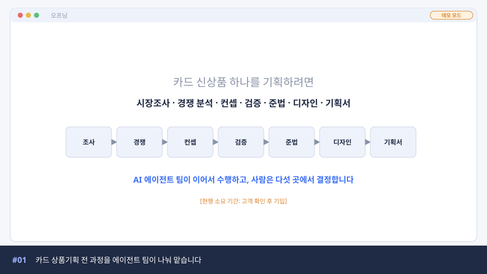
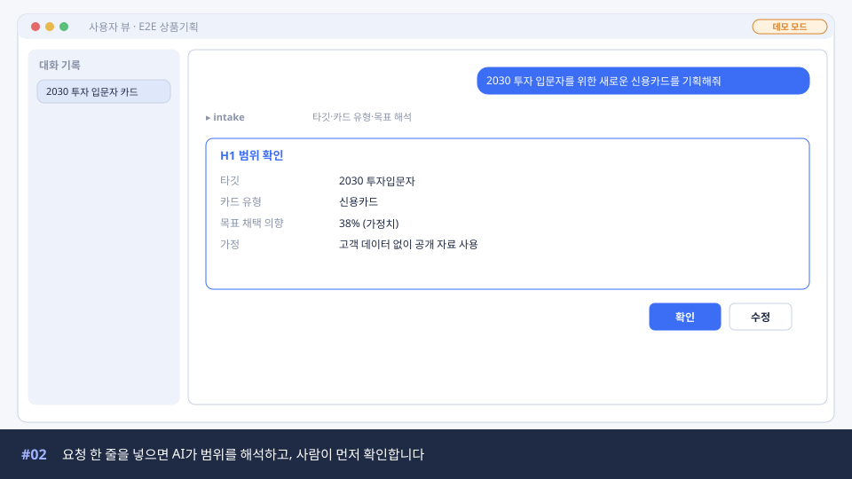
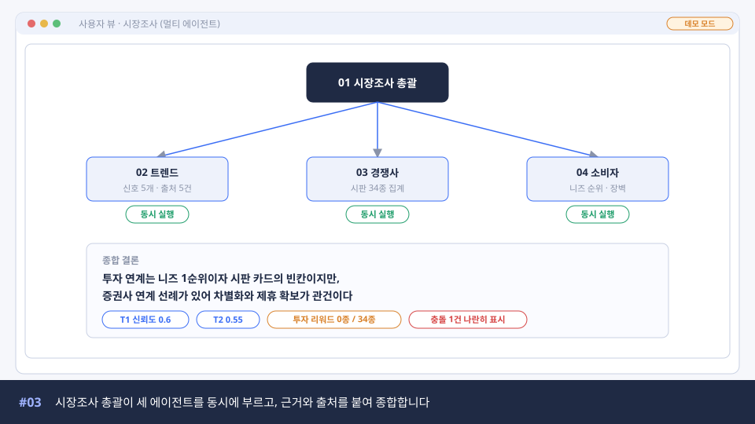
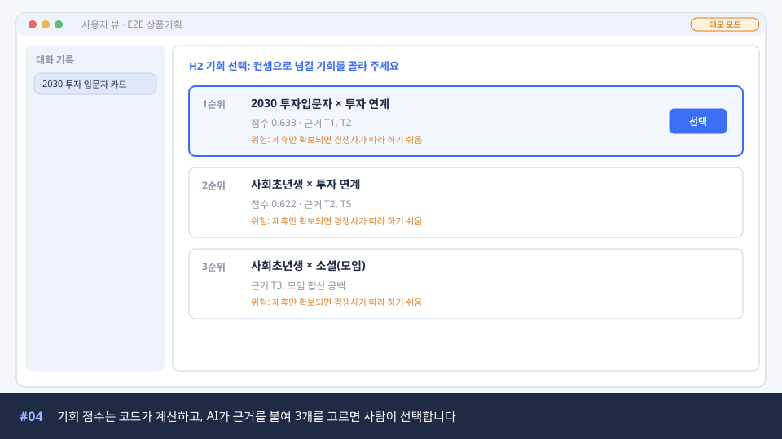
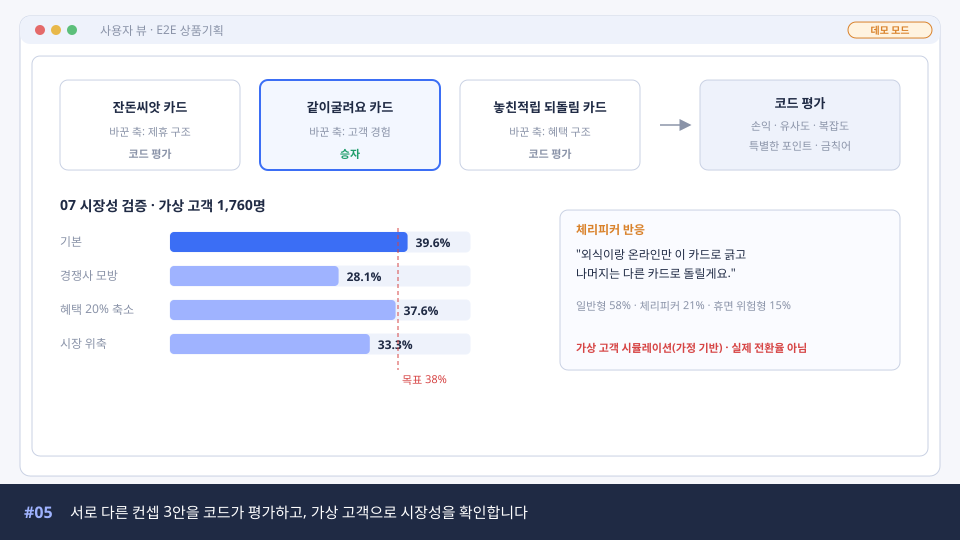
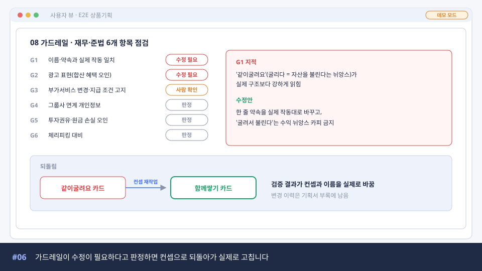
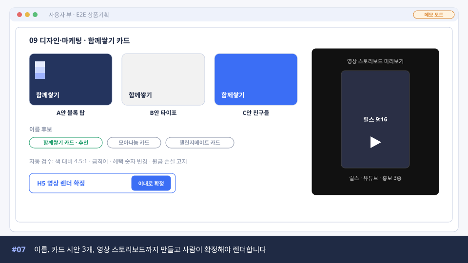
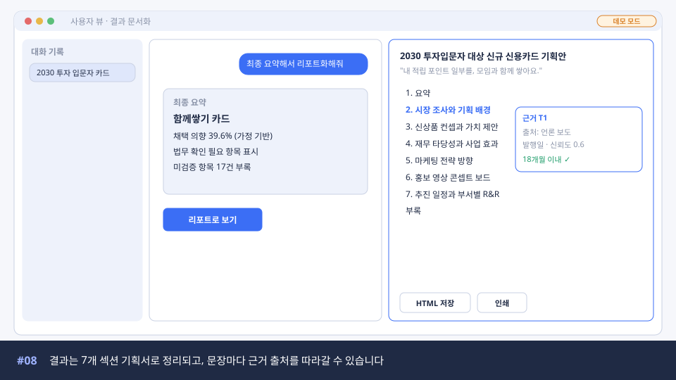
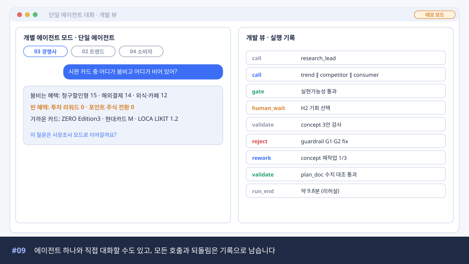
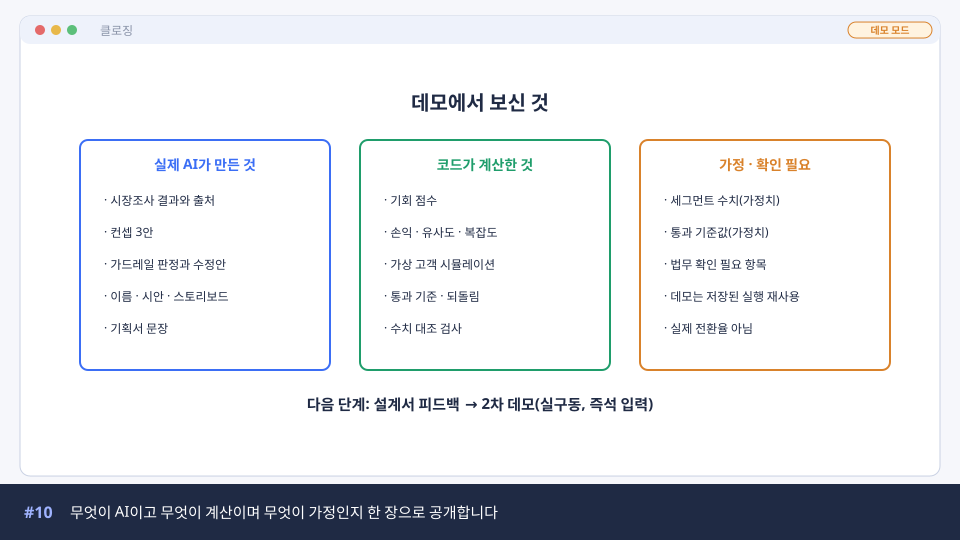

# 데모영상 스토리보드

## 영상 개요

| 항목 | 내용 |
|---|---|
| 제목(가안) | 카드 신상품 기획 AI 에이전트: 요청 한 줄에서 기획서까지 |
| 길이 | 본편 3분 40초. 편집본 2종(아래 "편집본" 참고) |
| 시청자 | 고객사 경영진, 기술 검토 담당(AX기획·AX개발), 외부 고객·투자자. 세 집단의 비중을 같게 본다 |
| 시나리오 | 2030 투자입문자 신용카드, E2E 상품기획(`04_데모_추천_시나리오.md`의 시나리오 A) |
| 화면 소스 | `ui/user-view.html`, `ui/dev-view.html`, `ui/reference/campaign-report.html`, `ui/assets/promo.mp4` |
| 실행 방식 | 리허설 실행 기록 재생(데모 모드). 화면에 "데모 모드" 배지를 계속 표시 |
| 나레이션 | 한국어, 차분한 설명조. 자막 상시 |

전체 흐름은 문제 제기 → 요청 → 멀티 에이전트 시장조사 → 사람 선택 → 컨셉·검증 → 검증이 결과를 바꾸는 장면 → 디자인·마케팅 → 기획서 → 단일 에이전트와 기록 → 무엇이 실제이고 무엇이 가정인지 순서다. 핵심 장면은 #03(멀티 에이전트가 동시에 일함), #06(검증이 컨셉을 바꿈), #08(결과가 근거 있는 문서로 남음)이다. 편집할 때 이 세 장면은 줄이지 않는다.

## 장면별 구성

이미지는 화면 구성을 보여 주는 와이어프레임이다. 실제 녹화는 `ui/` 화면으로 한다. 이미지 원본은 `assets/storyboard/make_frames.py`로 다시 만들 수 있다.

### #01 오프닝 (0:00 ~ 0:15, 15초)

| 항목 | 내용 |
|---|---|
| 화면 | 검은 바탕에 기획 단계 7개가 차례로 나타남 → 하나로 이어지는 화살표 |
| 나레이션 | "카드 신상품 하나를 기획하려면 시장조사, 경쟁 분석, 컨셉, 검증, 준법 검토, 디자인, 기획서까지 여러 부서가 오래 붙잡고 있어야 합니다. 이 과정을 AI 에이전트 팀이 나눠 맡으면 어떻게 될까요?" |
| 자막 | 카드 상품기획 전 과정을 에이전트 팀이 나눠 맡습니다 |
| 시청자별 포인트 | 경영진·투자자: 문제의 크기. 현행 소요 기간은 고객 확인 후 넣고, 확인 전에는 숫자 없이 간다 |
| 연출 메모 | 로고 없이 시작. 배경음은 낮게 |

### #02 요청 한 줄과 범위 확인 (0:15 ~ 0:35, 20초)

| 항목 | 내용 |
|---|---|
| 화면 | 사용자 뷰. 입력창에 "2030 투자 입문자를 위한 새로운 신용카드를 기획해줘" 타이핑 → 처리 로그 한 줄 → H1 범위 확인 카드(타깃, 카드 유형, 목표 38%(가정치), 가정) → "확인" 클릭 |
| 나레이션 | "담당자는 요청을 한 줄로 넣습니다. AI가 타깃과 카드 유형, 목표를 해석하면 사람이 먼저 확인합니다. 해석한 내용과 가정은 모두 기록에 남습니다." |
| 자막 | 요청 한 줄을 넣으면 AI가 범위를 해석하고, 사람이 먼저 확인합니다 |
| 시청자별 포인트 | 경영진: 쓰기 쉬움 / 기술: 해석은 규칙 먼저, 애매한 것만 AI |
| 연출 메모 | 타이핑은 실제 속도의 2배. "확인" 버튼에 커서 하이라이트 |

### #03 시장조사: 멀티 에이전트 동시 실행 (0:35 ~ 1:05, 30초)

| 항목 | 내용 |
|---|---|
| 화면 | 시장조사 총괄 아래 트렌드·경쟁사·소비자 카드가 동시에 켜짐 → 각 카드에 결과 요약(신호 5개, 시판 34종 집계, 니즈 순위) → 종합 결론 박스와 근거 칩(T1 신뢰도 0.6, 투자 리워드 0종/34종) |
| 나레이션 | "시장조사 총괄 에이전트가 질문을 트렌드, 경쟁사, 소비자 관점으로 나눠 세 에이전트를 동시에 부릅니다. 결과가 올 때마다 더 조사할지 판단하고, 근거마다 출처와 발행일, 신뢰도를 붙여 종합합니다. 서로 엇갈린 결과는 하나로 합치지 않고 나란히 보여 줍니다." |
| 자막 | 시장조사 총괄이 세 에이전트를 동시에 부르고, 근거와 출처를 붙여 종합합니다 |
| 시청자별 포인트 | 기술: 이 단계만 AI가 흐름을 정하는 멀티 에이전트 오케스트레이션 / 경영진: 근거를 따라갈 수 있음 |
| 연출 메모 | 세 카드가 켜지는 순간을 0.5초 간격으로. 실제 소요 시간은 화면 구석에 "실제 소요 약 N초"로 표기(리허설 기록 값 사용) |

### #04 기회 선택 (1:05 ~ 1:20, 15초)

| 항목 | 내용 |
|---|---|
| 화면 | H2 카드. 1순위 "2030 투자입문자 × 투자 연계(점수 0.633)", 2순위 "사회초년생 × 투자 연계(0.622)", 3순위 "사회초년생 × 소셜". 기회마다 위험 한 줄 → 1순위 선택 |
| 나레이션 | "기회 점수는 코드가 계산하고, AI가 근거와 위험을 붙여 세 개를 고릅니다. 어느 기회로 갈지는 사람이 정합니다." |
| 자막 | 기회 점수는 코드가 계산하고, AI가 근거를 붙여 3개를 고르면 사람이 선택합니다 |
| 시청자별 포인트 | 경영진: 사람이 결정권을 가짐 / 기술: 점수는 재현 가능한 코드 |

### #05 컨셉 3안과 시장성 검증 (1:20 ~ 1:50, 30초)

| 항목 | 내용 |
|---|---|
| 화면 | 컨셉 3안 카드(잔돈씨앗, 같이굴려요, 놓친적립 되돌림) → 코드 평가 → 같이굴려요 승자 표시 → 시장성 검증 막대(기본 39.6%, 경쟁사 모방 28.1%, 혜택 20% 축소 37.6%, 시장 위축 33.3%, 목표선 38%) → 체리피커 반응 인용 |
| 나레이션 | "컨셉 에이전트는 서로 다른 축으로 세 가지 안을 만듭니다. 손익과 경쟁 카드 유사도, 복잡도는 코드가 계산해 승자를 고릅니다. 그다음 가상 고객 1,760명으로 시장성을 봅니다. 경쟁사가 따라 하면 채택 의향이 28.1%까지 떨어진다는 것도 함께 보여 줍니다. 이 수치는 가정 기반 시뮬레이션이며 실제 전환율이 아닙니다." |
| 자막 | 서로 다른 컨셉 3안을 코드가 평가하고, 가상 고객으로 시장성을 확인합니다 |
| 필수 표기 | 화면 하단 고정: "가상 고객 시뮬레이션(가정 기반) · 실제 전환율 아님" |
| 시청자별 포인트 | 투자자·경영진: 숫자를 과장하지 않음 / 기술: 숫자는 코드, 반응은 AI |

### #06 가드레일이 컨셉을 바꾼다 (1:50 ~ 2:20, 30초)

| 항목 | 내용 |
|---|---|
| 화면 | 가드레일 6개 항목 판정(G1·G2 수정 필요, G3 사람 확인) → G1 지적과 수정안 확대 → "같이굴려요 카드"에서 "함께쌓기 카드"로 바뀌는 애니메이션 → "변경 이력은 기획서 부록에 남음" |
| 나레이션 | "가드레일 에이전트가 재무와 준법 관점에서 여섯 가지를 점검합니다. '같이굴려요'라는 이름이 투자 수익을 연상시킨다는 지적이 나오자, 시스템은 컨셉 단계로 되돌아가 고칩니다. 최종 이름은 '함께쌓기 카드'가 됐습니다. 법무 확인이 필요한 항목은 담당 부서가 지정되어 기획서에 미확인으로 남습니다." |
| 자막 | 가드레일이 수정이 필요하다고 판정하면 컨셉으로 되돌아가 실제로 고칩니다 |
| 시청자별 포인트 | 세 집단 모두에게 가장 중요한 장면. 점검 결과가 실제로 결과물을 바꾼다는 것 |
| 연출 메모 | 이 장면은 편집본에서도 줄이지 않는다. 이름이 바뀌는 순간 0.5초 정지 |

### #07 디자인·마케팅 (2:20 ~ 2:40, 20초)

| 항목 | 내용 |
|---|---|
| 화면 | 카드 시안 3개(A안 블록 탑, B안 타이포, C안 친구들) → 이름 후보 3개와 추천 → 영상 스토리보드 미리보기(`ui/assets/promo.mp4` 3초 삽입) → H5 "이대로 확정" |
| 나레이션 | "디자인·마케팅 에이전트는 이름 후보와 카드 시안 세 개, 홍보 영상 스토리보드를 만듭니다. 혜택 숫자를 바꾸거나 금칙어를 쓰면 자동 검수에서 걸립니다. 영상은 사람이 확정해야 만들어집니다." |
| 자막 | 이름, 카드 시안 3개, 영상 스토리보드까지 만들고 사람이 확정해야 렌더합니다 |
| 시청자별 포인트 | 투자자: 산출물의 폭 / 기술: AI는 내용만, 생김새는 템플릿 |

### #08 결과 문서화: 기획서 (2:40 ~ 3:05, 25초)

| 항목 | 내용 |
|---|---|
| 화면 | 채팅에 "최종 요약해서 리포트화해줘" → 최종 요약 → "리포트로 보기" → 오른쪽 패널에 7개 섹션 기획서 → 2절 문장의 근거 T1 클릭 → 출처·발행일·신뢰도 팝업 → HTML 저장 |
| 나레이션 | "모든 결과는 고객사 7개 섹션 틀의 기획서로 정리됩니다. 기획서 문장에서 근거를 누르면 출처와 발행일, 신뢰도가 나옵니다. 입력에 없는 숫자나 URL은 자동 검사에서 걸러지고, 아직 검증되지 않은 항목은 부록에 모입니다." |
| 자막 | 결과는 7개 섹션 기획서로 정리되고, 문장마다 근거 출처를 따라갈 수 있습니다 |
| 시청자별 포인트 | 경영진: 바로 보고에 쓸 수 있는 문서 / 기술: 수치 대조 검증 |

### #09 단일 에이전트 대화와 실행 기록 (3:05 ~ 3:25, 20초)

| 항목 | 내용 |
|---|---|
| 화면 | 왼쪽: 개별 에이전트 모드에서 경쟁사 에이전트에게 "시판 카드 중 어디가 붐비고 어디가 비어 있어?" → 답 / 오른쪽: 개발 뷰 실행 기록(call, gate, human_wait, reject, rework, run_end) |
| 나레이션 | "에이전트 하나를 골라 직접 대화할 수도 있습니다. 개발 화면에서는 어떤 에이전트가 언제 불렸고, 무엇이 반려되어 다시 만들어졌는지 모두 기록으로 확인할 수 있습니다." |
| 자막 | 에이전트 하나와 직접 대화할 수도 있고, 모든 호출과 되돌림은 기록으로 남습니다 |
| 시청자별 포인트 | 기술: 단일과 멀티를 같은 에이전트로, 같은 기록으로 / 경영진: 블랙박스가 아님 |

### #10 클로징: 무엇이 실제이고 무엇이 가정인가 (3:25 ~ 3:40, 15초)

| 항목 | 내용 |
|---|---|
| 화면 | 세 칸 정리표(실제 AI가 만든 것 / 코드가 계산한 것 / 가정·확인 필요) → 다음 단계 한 줄 |
| 나레이션 | "오늘 보신 결과 중 무엇을 AI가 만들고, 무엇을 코드가 계산했고, 무엇이 아직 가정인지 정리했습니다. 고객사 데이터와 기준을 받으면 가정치를 바꿔 다음 데모에서 실제 입력으로 다시 보여 드리겠습니다." |
| 자막 | 무엇이 AI이고 무엇이 계산이며 무엇이 가정인지 한 장으로 공개합니다 |
| 연출 메모 | 마지막 3초는 연락처나 다음 일정. 음악 페이드아웃 |

## 편집본

시청자 세 집단의 비중이 같으므로 본편 하나를 기준으로 두 가지 편집본을 만든다. 장면을 새로 찍지 않고 본편에서 잘라 쓴다.

| 편집본 | 길이 | 장면 | 쓰임 |
|---|---|---|---|
| 본편 | 3:40 | #01~#10 | 고객사 전 부서 데모, 게이트 리뷰 |
| 요약본 | 약 1:30 | #01(10초) → #02(10초) → #03(20초) → #06(25초) → #08(15초) → #10(10초) | 경영진 보고, 투자자 첫 소개 |
| 기술 부록 | 약 1:30 | #03 확장(호출 순서와 추가 조사 판단 로그) → #06 확장(반려 사유와 재작업 입력) → #09 확장(개발 뷰 레지스트리, 수치 대조 검사) | AX기획부·AX개발부, 기술 실사 |

## 장면별 소요 시간 합계

| 장면 | 시작 | 길이 |
|---|---|---|
| #01 오프닝 | 0:00 | 15초 |
| #02 요청과 범위 확인 | 0:15 | 20초 |
| #03 시장조사 | 0:35 | 30초 |
| #04 기회 선택 | 1:05 | 15초 |
| #05 컨셉과 시장성 검증 | 1:20 | 30초 |
| #06 가드레일 | 1:50 | 30초 |
| #07 디자인·마케팅 | 2:20 | 20초 |
| #08 기획서 | 2:40 | 25초 |
| #09 단일 에이전트와 기록 | 3:05 | 20초 |
| #10 클로징 | 3:25 | 15초 |
| 합계 | | 3분 40초 |

고객 기본안(PM 문서 Q7)은 "3분 내외"다. 고객이 3분을 넘기지 말라고 하면 #04를 #03 끝에 5초로 붙이고 #07을 15초로, #09를 15초로 줄여 3분 15초까지 맞출 수 있다.
