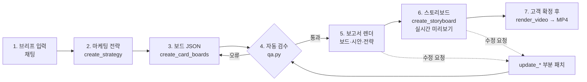
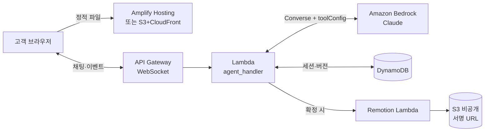

# 카드 디자인 에이전트 설계서

Oct 17, 2026 · @SULLI

> Claude Docs 원본에서 Markdown으로 내보낸 사본. 흐름도 2개는 Mermaid로 다시 그렸다.

## 개요

카드 브리프 한 줄을 받아 **디자인 보드 7장**과 영상 스토리보드 3종(릴스·유튜브·홍보)을 만드는 마케팅 디자인 에이전트 기능이다. PULSE 체크카드 작업에서 검증한 흐름을 일반화해, 타깃·컨셉·카드 종류가 바뀌어도 같은 구성과 품질로 결과가 나오게 한다.

핵심 원칙은 하나다. **LLM은 내용(JSON)만 만들고, 생김새는 템플릿이 책임진다.** 그래서 컨셉이 달라도 보드 레이아웃, 소재 표현, 영상 연출의 완성도가 일정하게 유지된다.

| 구분 | 내용 |
| --- | --- |
| 입력 | 자유 형식 브리프 (예: "20대 직장인용 여행 특화 카드, 차분한 무드"). 선택 입력: 브랜드명, 카드 종류(신용/체크), 혜택 목록, 금지 표현 |
| 산출물 1 · 보드 | 디자인 보드 1장 + 시안 목업 3장 + 디자인 포인트 3장 |
| 산출물 2 · 영상 | 릴스(9:16, 18초), 유튜브(16:9, 25초), 홍보 영상(16:9, 20초)의 스토리보드 JSON → MP4 |
| 표시 위치 | 고객용 웹페이지의 채팅 옆 보드 뷰어, 영상 미리보기 플레이어 |
| 수정 | 채팅으로 요청하면 해당 부분 JSON만 고쳐 다시 그린다 |

적용 범위는 신용·체크카드 신규 디자인이다. 같은 구조로 선불카드, 멤버십 카드, 굿즈형 카드까지 확장할 수 있다.

## 전체 흐름도

모든 단계의 결과는 JSON으로 저장되고, 자동 검수를 통과한 것만 렌더된다. 수정 요청은 처음부터 다시 만들지 않고 바뀐 부분만 패치해 보드나 영상을 다시 그린다.

## AWS 아키텍처

백엔드는 Bedrock Converse API를 `toolConfig`와 함께 호출해, 모델이 자유 텍스트 대신 스키마에 맞는 JSON을 돌려주게 한다. 보드는 JSON만 내려보내 브라우저의 렌더러가 그리고, 영상만 서버에서 렌더해 S3에 올린다.

- **프론트**: Amplify Hosting(또는 S3 + CloudFront). React든 순수 HTML이든 보드 렌더러 모듈을 그대로 불러 쓴다.
- **백엔드**: API Gateway WebSocket으로 응답을 스트리밍하고, Lambda가 대화 루프와 도구 처리, 자동 검수를 맡는다. 대화가 길어져 15분 제한이 문제되면 ECS Fargate로 옮긴다.
- **영상**: Remotion Lambda가 스토리보드 JSON을 props로 받아 렌더한다. 렌더는 비동기 작업이라 백엔드는 작업 ID만 돌려주고, 완료되면 서명 URL을 푸시한다.
- **저장**: DynamoDB에 세션별 대화 기록과 JSON 버전을 남겨, "아까 버전으로 돌려줘"를 처리한다.

## 데이터 구조

에이전트의 모든 산출물은 JSON 두 종류로 표현된다. 보드는 `card_boards`, 영상은 `storyboard`이고, 둘 다 Bedrock 도구 호출의 입력 스키마로 강제한다. 전체 스키마는 구현 키트의 `schema/` 폴더에 있다.

### card\_boards (디자인 보드 7장)

| 필드 | 타입 | 설명 |
| --- | --- | --- |
| `brand` | object | 브랜드명, 카드 종류(credit/check), 발급사 자리표시 `[ISSUER]` |
| `target` | object | 세그먼트 한 줄, 생활 맥락 3\~5개(예: 페스티벌, 숏폼). 브리프에서 추론한 값은 `assumed: true` |
| `concept` | object | 태그라인, 컨셉 문장(2문장 이내), 키워드 6개(마지막 1개는 강조) |
| `palette` | array(6) | `name`, `hex`, `role`(ground/ink/accent/support). accent는 1개만 |
| `typography` | object | display / body / mono 서체명. 템플릿이 지원하는 목록 안에서만 고른다 |
| `layout` | object | `orientation`(vertical/horizontal), `front_rule`(예: 앞면엔 칩과 로고만) |
| `variants` | array(3) | 시안 3개. 각각 `code`(HOLO 같은 짧은 이름), `material`(프리셋 + 파라미터), `colors`, `front`, `back`, `story` |
| `variants[].story` | object | 헤드라인, 리드, 포인트 4개(`title`, `body`, 카드 위 표시 위치 `anchor`), 페르소나 한 줄, 무드 키워드 3개 |
| `benefits` | array | 선택. 혜택이 들어오면 채운다 (8장 참고) |

### storyboard (영상 1편)

| 필드 | 타입 | 설명 |
| --- | --- | --- |
| `format` | enum | `reels` / `youtube` / `promo` |
| `aspect`, `fps`, `duration_s` | 값 | 9:16 또는 16:9, 30fps, 길이 |
| `bpm` | number | 컷 박자 기준. 홍보 영상은 필수, 나머지는 선택 |
| `hero_variant` | string | 릴스처럼 한 시안에 집중할 때 주인공 시안 코드 |
| `scenes` | array | 장면 순서. 각 장면은 `preset`(6장 목록), `start_s`, `duration_s`, `variant`, 프리셋별 `params` |
| `scenes[].captions` | array | 자막. 단어 배열 + 강조 단어 인덱스, 시작·끝 초, 위치(top/bottom/left) |
| `ending` | object | 엔딩 타입(`stack_lockup`), 통합 카피, CTA 문구(예: COMING SOON) |
| `audio` | object | BGM 무드, 템포. 음원 파일은 사람이 넣는다 |

수정 요청은 이 JSON의 일부만 바꾸는 `update_card_boards`, `update_storyboard` 도구로 처리한다. 경로와 새 값을 주는 패치 방식이라, 다른 시안과 장면은 그대로 유지된다.

## 마케팅 방향성 전략

에이전트는 디자인보다 **전략을 먼저 쓴다**(`create_strategy`). 보드와 영상은 이 전략을 따르고, 검수기는 보드의 시안 코드가 전략의 페르소나와 맞는지 확인한다. 전략은 `schema/marketing_strategy.schema.json` 구조를 따른다.

| 항목 | 내용 | 지켜야 할 것 |
| --- | --- | --- |
| 포지셔닝 | 누구에게, 무엇을, 왜 다른가를 한 문장으로 | 경쟁사 이름·비교 금지 |
| 타깃 인사이트 | 지금의 불편 → 진짜 바라는 것 | 고객 리서치가 없으면 '검증 필요 가설'로 표시하고 검증 방법을 함께 적음 |
| 페르소나 3명 | 각자 시안 하나와 일상의 한 순간에 연결 | 이 순간이 유튜브 생활 장면이 됨 |
| 메시지 축 3개 | 할 말 + 제품·디자인 근거 | 근거 없는 기능·혜택 금지 |
| 톤앤매너 | 한 줄 요약, 이렇게 / 피하기 | — |
| 채널 | 채널별 역할 1개 + 쓰는 자산(릴스·유튜브·홍보·보드 등) + 주도 단계 | 단계 이름은 로드맵과 일치 |
| 런칭 단계 | 2\~4단계, 런칭일 기준 D-day 상대 일수 | 단계가 겹치지 않고 D-day를 포함. 실제 날짜는 런칭일이 정해진 뒤 |
| KPI | 인지·관심·전환·확산 단계별 지표와 측정처 | 고객이 준 숫자가 없으면 목표값은 \[목표값\] |
| 리스크 | 소재 제작 가능성, 혜택 추가 시 심의, 실존 브랜드 연상 등 + 대응 | — |

## 최종 화면: 캠페인 보고서

고객이 보는 결과물은 한 장의 보고서 페이지다(`report/report-renderer.js`). 표지, 요약, 마케팅 방향성, 채널 전략, 런칭 로드맵(D-day 타임라인), KPI, 디자인 컨셉 보드, 시안 3종(목업 + 디자인 포인트), 컨셉 영상(실시간 미리보기 + 장면 목록), 리스크와 다음 단계 순서로 구성된다. 도구 호출이 끝날 때마다 바뀐 데이터로 다시 그려지고, 아직 없는 부분(예: 영상)은 '요청하면 추가돼요' 상태로 보인다. 색과 서체는 캠페인 팔레트에서 가져오고, 밝은 테마와 어두운 테마를 모두 지원한다.

## 에이전트 규칙

결과 품질은 이 규칙이 결정한다. 전문은 `prompts/system_prompt.md`에 있고, 아래는 핵심만 추린 것이다.

### 브리프 해석

1. 브리프에서 타깃, 생활 맥락, 원하는 무드를 뽑는다. 없는 값은 추론하되 `assumed: true`로 표시하고 첫 응답에서 한 줄로 밝힌다.
2. 질문은 최대 1개만 한다. 답이 없어도 기본값으로 진행한다.
3. 브랜드명이 없으면 가상의 이름을 만든다. 실존 카드사, 결제 네트워크, 다른 회사 브랜드는 쓰지 않는다.

### 카드 방향(세로/가로) 정하기

에이전트가 컨셉을 보고 가장 먼저 정하고, 이유를 `layout.orientation_reason`에 한 줄로 남긴다. 첫 응답에서 고객에게도 알려, 한 번의 수정으로 바꿀 수 있게 한다.

| 방향 | 이럴 때 | 배치 규칙 |
| --- | --- | --- |
| 세로 | 모바일·탭 결제 중심, 굿즈처럼 보여주는 카드, 큰 세로 로고가 주 그래픽, 트렌드에 민감한 젊은 타깃 | 칩 왼쪽 위, 세로 로고 왼쪽 아래, 번호는 뒷면 2줄 |
| 가로 | 클래식·프리미엄·실용, 여행·여권 지갑, 비즈니스나 높은 연령대, 넓은 그라데이션·일러스트 | 로고 왼쪽 위, 칩 왼쪽 가운데(7.2mm, 19.4mm), 컨택리스는 칩 오른쪽, 뒷면 자기 띠 + 서명란 + 번호 1줄 |

신호가 없으면 30세 미만 타깃은 세로, 그 외는 가로를 기본값으로 한다. 고객이 방향을 지정하면 그대로 따른다. 가로형 배치는 디자인 캔버스의 '가로형 배치 규격' 보드를 기준으로 렌더러에 반영했다.

### 시안 3개 차별화

- 세 시안은 **소재 프리셋이 모두 달라야 한다.** 같은 프리셋을 쓰려면 파라미터(색, 마감)가 확실히 달라야 한다.
- 무드도 겹치지 않게 축을 나눈다. 예: 낮/밤, 화려함/절제, 따뜻함/차가움.
- 세 시안은 같은 팔레트 안에서 고른다. 브랜드 일관성은 팔레트와 서체가, 차별화는 소재와 무드가 맡는다.

### 디자인 포인트 작성법

- 포인트는 시안당 4개. 각 포인트는 '카드의 구체적 디테일 → 타깃 인사이트 → 무드' 순서로 쓴다.
- 모든 포인트는 카드 위 위치(`anchor`: chip, logo, material, edge, back 등)를 가져야 번호 표시를 붙일 수 있다.
- 본문은 2문장, 70자 이내. 이유 없는 형용사보다 장면을 쓴다(예: "페스티벌 조명 아래").

### 카피 규칙

- 짧은 2줄 구조: 1줄은 상황, 2줄은 결론. 마지막 단어는 강조색으로 처리할 수 있게 단어 배열로 넘긴다.
- 통계, 순위, 혜택 수치를 지어내지 않는다. 혜택은 입력으로 받은 것만 쓴다.
- 출시일, 가격, 연회비처럼 정해지지 않은 정보는 `[PRICE]`, COMING SOON 같은 자리표시로 둔다.

### 금지사항

- 실존 브랜드 로고·트레이드 드레스 모방, 실존 인물, 실제 카드번호 형식(테스트 번호도 금지). 카드번호는 0으로 시작하는 가짜 번호만 쓴다.
- 이모지, 의미 없는 그라데이션 배경, 흔한 AI 서체(Inter, Roboto, Arial) 기본값.
- 금융 광고 규제 문구가 필요한 표현("무조건", "최고 혜택")은 쓰지 않는다. 실제 집행 전에는 준법 검토를 거친다.

## 소재 프리셋과 장면 프리셋

LLM은 프리셋 이름과 파라미터만 고르고, 표현은 렌더러가 만든다. 새 소재나 장면이 필요하면 렌더러에 프리셋을 추가하고 스키마의 enum에 이름을 넣는다.

### 소재 프리셋 (보드 렌더러 + 영상 공통)

| 프리셋 | 표현 | 파라미터 | 어울리는 무드 |
| --- | --- | --- | --- |
| `holo` | 각도마다 색이 흐르는 회절 필름, 빛줄기, 미세 반짝임 | `tint`(pastel/vivid), `line_angle` | 축제, 반짝임, Y2K |
| `clear` | 반투명 프로스트 아크릴, 안테나 코일 노출, 배경 비침 | `tint`, `coil`(true/false), `frost`(0\~1) | 투명, 담백, 테크 |
| `metal` | 무광 또는 브러시드 금속, 노이즈 질감, 컬러 엣지 | `base`(black/silver/gold), `edge_color`, `finish`(matte/brushed) | 시크, 프리미엄, 밤 |
| `matte` | 단색 무광 PVC, 미세 입자감 | `color` | 미니멀, 차분 |
| `gradient` | 2\~3색 부드러운 그라데이션, 반사광 | `stops`(팔레트 이름 2\~3개), `angle` | 감성, 노을, 몽환 |

공통 요소인 칩(실버/골드/그레이), 컨택리스 아이콘, 세로 로고, 뒷면 정보 배치는 모든 프리셋에서 같은 위치 규칙을 따른다.

### 장면 프리셋 (영상)

| 프리셋 | 하는 일 | 주로 쓰는 영상 |
| --- | --- | --- |
| `hero_reveal` | 카드가 옆면에서 돌며 등장, 빛줄기가 지나감 | 릴스 |
| `detail_closeup` | 로고·칩·소재로 카메라가 다가가는 클로즈업 | 릴스 |
| `flip` | 앞면 → 뒷면 → 앞면 회전 | 릴스 |
| `fan_merge` | 시안 3장이 부채꼴로 펼쳐졌다 한 묶음으로 합쳐짐 | 릴스 엔딩 |
| `life_night_light` | 밤 공연장, 조명 빔이 지나갈 때 카드가 번쩍임(폰 케이스 등) | 유튜브 |
| `life_daylight_seethrough` | 낮 야외, 투명 카드 너머로 풍경이 비침 | 유튜브 |
| `life_tap_pay` | 어두운 매장에서 단말기에 태그, 결제 완료 화면 | 유튜브 |
| `split_merge` | 장면 3개가 3분할로 떴다가 합쳐지며 카드가 모임 | 유튜브 엔딩 |
| `beat_words` | 비트마다 배경색이 바뀌며 큰 단어 하나씩 | 홍보 |
| `material_marquee` | 소재 이름 아웃라인 글자가 흐르는 배경 위 카드 | 홍보 |
| `lineup_pulse` | 카드 3장이 서 있고 심박 선이 지나가며 하나씩 튐 | 홍보 |
| `stack_lockup` | 카드 묶음 + 통합 카피 + 로고 + CTA. 세 영상 공통 엔딩 | 전체 |

`life_*` 프리셋은 카드 컨셉에 맞는 생활 장면을 고르는 슬롯이다. 컨셉이 바뀌면(예: 여행 카드) `life_airport`, `life_cafe` 같은 프리셋을 추가해 같은 방식으로 확장한다.

## 영상 3종 설계

세 영상은 역할을 나눠 맡는다. 릴스는 제품, 유튜브는 일상 스토리, 홍보 영상은 브랜드 태도를 보여주고, 엔딩은 모두 `stack_lockup`으로 통일한다.

| 항목 | 릴스 | 유튜브 | 홍보 영상 |
| --- | --- | --- | --- |
| 역할 | 제품 자체를 보여줌 | 카드를 쓰는 순간의 생활 장면 | 브랜드 매니페스토 |
| 비율 · 길이 | 9:16 · 18초 | 16:9 · 25초 | 16:9 · 20초 |
| 시안 | 주인공 1개 집중, 엔딩에서 3개 | 시안마다 장면 1개씩 | 3개 모두, 비트마다 교차 |
| 장면 구성 | hero\_reveal → detail\_closeup ×2 → flip → fan\_merge → stack\_lockup | life 장면 ×3 (각 6.5초) → split\_merge → stack\_lockup | 심박 인트로 → beat\_words(12비트) → material\_marquee ×3 → lineup\_pulse → stack\_lockup |
| 카피 수 | 자막 6개 이하 | 장면당 2줄 | 비트 단어 9개 + 소재 태그라인 3개 |
| 리듬 | 장면당 2\~3.5초 | 장면당 6.5초 | 120BPM(15프레임) 하드컷 |

### 미리보기 먼저, MP4는 확정 후

스토리보드는 만들어지는 즉시 고객 페이지에서 **실시간 미리보기**로 재생된다. `player/storyboard-player.js`가 같은 JSON을 브라우저에서 매 프레임 그리기 때문에 렌더링 대기가 없고, 재생·정지·구간 이동이 된다. 카드는 보드와 같은 렌더러로 그려서 소재와 색이 보드와 일치한다.

| 단계 | 누가 | 걸리는 시간 |
| --- | --- | --- |
| 스토리보드 생성·수정 (`create_storyboard`, `update_storyboard`) | 모델 → 페이지가 바로 재생 | 수 초 |
| 고객 확인 후 확정 ("이대로 확정") | 고객 | 고객 판단 |
| MP4 렌더 (`render_video`, 확정 문구를 `approval_quote`로 기록) | Remotion Lambda | 영상당 1\~2분 예상 |

모델은 스토리보드를 만들거나 고친 직후에는 절대 렌더하지 않는다. 수정 반복은 미리보기에서 끝내고, MP4는 확정본 한 번만 만든다.

### 공통 규칙

- **첫 1\~2초에 카드가 보여야 한다.** 릴스와 홍보 영상은 0초부터, 유튜브는 첫 장면 안에서 바로.
- 자막은 단어 단위로 4프레임 간격을 두고 떠오르게 하고, 마지막 단어는 강조색(밝은 배경에서는 형광펜 마커)을 쓴다.
- 안전 영역: 9:16은 좌우 80px·상하 100px, 16:9는 좌우 140px·상하 100px 안에 글자를 둔다.
- 음원은 무음으로 납품하고 `bpm`만 기록한다. 같은 템포의 라이선스 음원을 깔면 컷이 박자에 맞는다.
- 렌더링은 Remotion 컴포지션 3개(`Reels`, `YouTube`, `Promo`)가 스토리보드 JSON을 props로 받는다. 이번에 Python으로 만든 프로토타입이 각 장면 프리셋의 동작 기준이다.

## 카드 혜택 반영 가이드 (향후)

지금은 제작하지 않는다. 혜택이 입력으로 들어오면 아래 규칙대로 보드와 영상에 반영한다. 혜택이 없으면 이 장은 건너뛴다.

### 입력 형식

`benefits` 배열에 혜택마다 `category`(예: 공연·페스티벌, 카페, 대중교통), `headline`(사람이 확정한 문구), `detail`(조건), `source`(상품설명서 등 근거)를 받는다. **수치와 조건은 사람이 준 값만 쓰고, LLM이 만들거나 반올림하지 않는다.**

### 반영 위치

| 산출물 | 반영 방식 |
| --- | --- |
| 디자인 보드 | 보드 하단에 혜택 띠 추가: 카테고리 아이콘 + headline 최대 3개 |
| 디자인 포인트 | 시안의 생활 맥락과 맞는 혜택 1개를 '이런 사람에게' 영역에 연결 (예: 페스티벌 장면 ↔ 공연 혜택) |
| 릴스 | 엔딩 직전 2초 `benefit_card` 장면: 혜택 headline 1개를 큰 글자로 |
| 유튜브 | 각 생활 장면의 두 번째 자막 줄을 그 장면과 맞는 혜택 headline으로 교체할 수 있음 |
| 홍보 영상 | `beat_words` 중 3비트를 혜택 키워드로 교체, 엔딩에 혜택 요약 1줄 |

### 지켜야 할 것

- 혜택 문구 옆에 조건 요약(실적 조건, 한도)을 같은 화면에 작게라도 노출한다. 영상에서는 하단 고지 자막으로 처리한다.
- "최대", "무제한" 같은 표현은 입력 문구에 있을 때만 쓴다.
- 혜택이 들어간 산출물은 집행 전 준법 검토 대상으로 표시(`needs_compliance_review: true`)한다.

## 수정 요청, 품질 검수, 보안

### 수정 요청 처리

| 요청 예 | 에이전트 동작 |
| --- | --- |
| "2번 시안 좀 더 차분하게" | `update_card_boards`로 해당 시안의 `material.params`, `colors`, `story`만 패치 |
| "전체 색감 따뜻하게" | `palette` 패치 → 보드·영상 모두 다시 렌더 |
| "릴스 첫 장면 더 빠르게" | `update_storyboard`로 해당 장면 `duration_s`만 수정 |
| "이 컨셉 말고 완전히 다른 방향" | 새 `card_boards` 생성, 이전 버전은 히스토리로 보관 |

보드가 바뀌면 영상 스토리보드도 같은 시안 코드를 참조하므로 자동으로 따라간다. 영상만 바꾸는 요청은 보드를 건드리지 않는다.

### 품질 검수 체크리스트 (서버에서 자동 검사)

- [ ] 스키마 검증 통과, 시안 3개의 소재 프리셋 또는 파라미터가 서로 다름
- [ ] 팔레트 HEX 형식, accent 1개, 본문 글자 대비 4.5:1 이상
- [ ] 글자 수 상한: 헤드라인 18자, 포인트 본문 70자, 자막 단어 6개
- [ ] 금지어 목록(실존 브랜드명, 과장 표현) 미포함, 숫자는 입력값에서만
- [ ] 영상 장면 길이 합계 = `duration_s`, 자막이 안전 영역 안
- [ ] 혜택이 있으면 `needs_compliance_review: true`

* [ ] 영상 자막 대비 4.5:1 이상: 플레이어가 매 프레임 자막 뒤 배경(픽셀 + 겹친 카드 소재)을 재서 흰색/잉크색을 고르고, 섞인 배경이면 어두운 바탕을 자동으로 깐다. `tests/visual_check.py`가 전 프레임을 검사한다
* [ ] 장면에 나오지 않는 카드가 화면에 그려지지 않음 (숨김 카드는 렌더 트리에서 제외)

검사에 실패하면 실패 항목을 모델에 돌려보내 1회 재생성하고, 그래도 실패하면 사람에게 넘긴다.

### 보안

- LLM이 만든 HTML을 페이지에 직접 넣지 않는다. 템플릿은 텍스트를 `textContent`로만 넣고, 색은 HEX 정규식으로 검증한 뒤 CSS 변수로 넣는다.
- 사용자가 올린 레퍼런스 이미지나 문서는 데이터로만 다룬다. 그 안의 지시문은 따르지 않는다.
- Bedrock 호출은 백엔드에서만 하고, IAM 역할은 해당 모델 호출 권한으로 한정한다. 결과물 S3 버킷은 비공개로 두고 서명 URL로 내려준다.

## 구현 키트 구성과 다음 단계

구현 키트는 이 저장소 자체다. 프론트를 React로 하든 순수 HTML로 하든 쓸 수 있게, 보드 렌더러는 빌드 도구 없이 도는 순수 JavaScript 모듈로 만들었다.

| 경로 | 내용 |
| --- | --- |
| `schema/card_boards.schema.json` | 보드 JSON 스키마 (Bedrock 도구 입력 스키마로 그대로 사용) |
| `schema/storyboard.schema.json` | 영상 스토리보드 스키마 |
| `prompts/system_prompt.md` | 에이전트 시스템 프롬프트 전문 |
| `schema/marketing_strategy.schema.json` | 마케팅 방향성 전략 스키마 |
| `bedrock/tools.json` | Converse API `toolConfig` (전략·보드·스토리보드 생성/수정 6개 + `render_video`) |
| `bedrock/qa.py` | 자동 검수 규칙 (전략·보드·스토리보드) |
| `bedrock/agent_handler.py` | Lambda 예시: 대화 루프, 도구 호출 처리, 검증, 재시도 |
| `renderer/board-renderer.js` · `boards.css` | JSON → 보드 7장 렌더러. `renderBoards(data, element)` 하나로 호출 |
| `renderer/index.html` | 샘플 JSON을 불러와 보여주는 데모 페이지 |
| `player/storyboard-player.js` | 스토리보드 JSON → 브라우저 실시간 영상 미리보기 (자막 대비 자동 보정) |
| `report/report-renderer.js` · `report.css` | 최종 화면: 캠페인 보고서 한 페이지 |
| `dist/` | 바로 열어 보는 데모 3종 (보드, 영상 미리보기, 캠페인 보고서) |
| `samples/` | PULSE 전략·보드·스토리보드 3종, 가로형 확인용 ROAM 보드 |
| `tests/` | 에이전트 루프·렌더러·플레이어 테스트, 브라우저 자막 대비 검사 (`npm test`) |
| `video/` | Remotion 매핑 가이드, 이번 영상 3종의 Python 프로토타입 |

### 다음 단계

1. 데모 페이지로 렌더러를 확인하고, 프론트 프레임워크가 정해지면 `renderBoards`를 컴포넌트로 감싼다.
2. Bedrock에서 사용할 Claude 모델 ID를 계정 리전에 맞게 확정하고 `agent_handler.py`에 넣는다.
3. Remotion 프로젝트를 만들어 장면 프리셋을 프로토타입 기준으로 하나씩 옮긴다. `stack_lockup`과 `hero_reveal`부터 시작한다.
4. 다른 컨셉 브리프 3\~5개로 회귀 테스트를 돌려, 시안 차별화와 글자 수 규칙이 지켜지는지 확인한다.
