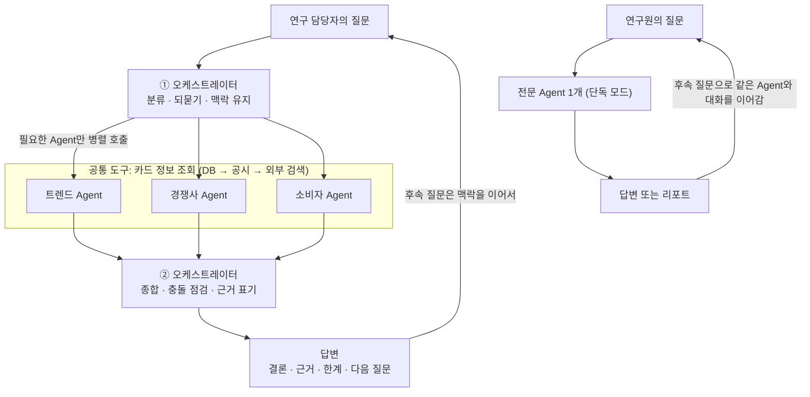

# 신상품 카드 기획: 시장조사 Agent 시나리오 및 설계안

2026-10-15 기준. 문서의 카드명, 수치, 대화 예시는 모두 설명용 가상 값이다.

## 1. 개요와 개정된 전제

시장조사 파트는 카드 정보를 'DB → 카드사 공시 페이지 → 외부 검색' 순서로 찾고, 통합 대화와 Agent 단독 대화를 모두 다중 턴 대화로 지원하는 구조로 설계한다. 이 문서는 그 전제로 시나리오, 호출 순서도, Agent별 프롬프트·스키마, 대화 스크립트를 정리한 것이다.

**현재 전제**

| 구분 | 전제 | 설계에 미치는 영향 |
| --- | --- | --- |
| 자사·경쟁사 카드 정보 | 향후 카드 상품 정보를 DB화해서 불러옴. 현재는 DB가 없으므로 카드사 공시 페이지와 외부 검색으로 찾음. DB가 생긴 뒤에도 DB에 없는 항목은 공시·외부 검색으로 보완 | 모든 Agent가 같은 '카드 정보 조회' 도구를 쓰고 조회 경로(DB, 공시, 검색)를 답변에 표시. DB 연동 시 도구 내부만 바꾸면 되도록 인터페이스를 먼저 고정 |
| 자사 정보의 범위 | 카드 상품 정보(혜택, 연회비, 이용 조건, 변경 이력)까지. 회원·결제·성과 같은 내부 데이터는 범위 밖 | 내부 성과가 필요한 판단은 '내부 데이터 확인 필요'로 표시하고 공개 지표로 대체 |
| 소비자 Agent의 데이터 | 감성 데이터, 카드 커뮤니티 API, 웹에 공개된 소비동향 자료, 발표자료만 읽음 | 수치는 '언급·반응 경향'이며 실제 이용 비중이 아님을 항상 표시 |
| 첨부·입력 자료 | 첨부 업로드 기능은 현재 고려하지 않음 | 자사 카드는 카드명을 말하면 DB·공시로 찾고 카드명이 불분명하면 되묻기. 기획 중인 카드처럼 DB·공시에 없는 내용은 연구원이 대화에서 말한 것만 맥락으로 사용 |
| 활용 형태 | 통합 대화와 Agent 단독 대화 모두 대화의 흐름이 있음 | 각 Agent가 독립적으로 맥락 유지, 되묻기, 범위 밖 질문 안내를 수행하고 오케스트레이터는 그 위의 선택적 층 |

## 2. Agent 구성과 정보 조회 구조

오케스트레이터 1개와 전문 Agent 3개가 공통 '카드 정보 조회' 도구와 각자의 외부 데이터로 답하며, 오케스트레이터 없이 각 Agent와 직접 대화할 수도 있다.

| Agent | 맡는 질문 | 읽는 데이터 | 하지 않는 일 |
| --- | --- | --- | --- |
| 오케스트레이터 | 질문 분류, 맥락 유지, 되묻기, 종합, 충돌 조율 | 대화 이력, 각 Agent 결과 | 직접 사실을 지어내거나 근거 없이 결론 내기 |
| 트렌드 Agent | 소비·결제 트렌드, 규제·정책, 거시 환경, 신기술 | 뉴스, 정부·금융당국 발표, 업계 리포트, 공개 통계, 검색 트렌드 | 특정 카드사의 내부 성과 추정 |
| 경쟁사 Agent | 카드 상품 비교(타사와 자사를 같은 양식으로), 혜택·연회비·전월실적, 프로모션, 포지셔닝 | 카드 정보 조회 도구(DB → 공시 → 검색), 보도자료, 비교 사이트 | 비공개 수익성·가입자 수 단정 |
| 소비자 Agent | 소비자 반응, 선택 동기, 불만, 이탈 요인, 세그먼트 관심사 | 감성 데이터, 카드 커뮤니티 API, 웹에 공개된 소비동향 자료, 발표자료 | 자사 회원·결제 데이터 조회, 개인 식별 가능한 정보 처리 |

**카드 정보 조회 도구 (모든 Agent 공통)**

| 순서 | 소스 | 현재 상태 | 규칙 |
| --- | --- | --- | --- |
| 1 | 카드 정보 DB (자사·경쟁사 상품) | 향후 연동. 연동 전에는 건너뜀 | 기준 일자와 함께 가져옴 |
| 2 | 카드사 공시 페이지, 상품설명서, 약관 | 현재 기본 소스 | 공식 자료이므로 외부 검색보다 우선 |
| 3 | 외부 검색 (보도자료, 비교 사이트, 뉴스) | DB·공시에 없을 때 보완 | 공식 자료와 다르면 공식 자료를 우선하고 차이를 표시 |

- 상위 소스에서 필요한 항목을 모두 찾으면 하위 소스는 쓰지 않고, 일부만 찾았으면 없는 항목만 다음 소스로 보완한다.
- 소스끼리 값이 다르면 하나를 고르지 않고 둘 다 보여주며 기준 일자를 붙인다.
- 자사 카드사명은 설정값으로 두고, 어떤 카드를 가리키는지는 대화에서 카드명으로 확인한다. 이름이 비슷한 카드가 여럿이면 되묻는다.
- 내부 성과·회원·결제 데이터는 범위 밖이므로, 그런 데이터가 필요한 질문에는 '내부 데이터 확인 필요'라고 답하고 공개 지표로 대신할 수 있는 부분만 답한다.

**모든 Agent 공통 대화 규칙 (통합·단독 모두 적용)**

- 답변마다 출처 유형(DB, 공시, 검색, 커뮤니티 등), 기준 시점, 신뢰도를 붙인다.
- 확인되지 않은 내용은 추정으로 구분해서 말한다.
- 질문이 모호하면 범위(세그먼트, 기간, 카드 유형)를 한 번에 하나씩 확인한다.
- 앞서 나온 세그먼트, 카드, 가정을 기억해 후속 질문에 이어서 답한다.
- 자기 영역 밖 질문은 억지로 답하지 않고 어느 Agent의 영역인지 알려준 뒤, 통합 모드로 이어갈지 제안한다.

## 3. 통합 시나리오: 시장조사 파트 전체 핑퐁 대화

연구 담당자가 오케스트레이터와 대화하면 필요한 Agent가 불려 나오는 구조이고, 8개 시나리오 모두 '막연한 질문 → 근거 요청 → 자사 카드와 비교 → 반박·검증 → 종합' 흐름을 따른다. 표기: (T)=트렌드, (C)=경쟁사, (S)=소비자, (O)=오케스트레이터. '자사 카드 정보'는 카드 정보 조회 도구(DB → 공시 → 검색)로 찾으며, 연구원이 카드명을 말해야 한다.

### 시나리오 1. 새 타겟 세그먼트 발굴 (트렌드에서 시작)

배경: 사회초년생 대상 신규 카드를 구상하지만 방향이 안 잡힌 상태.

1. 20대 후반~30대 초반 소비에서 눈에 띄는 변화는? (T)
2. 그중 카드 혜택으로 연결될 만한 영역은? (T)
3. 그 영역에 이미 상품을 낸 카드사는? 혜택 차이는? (C, 공시 → 검색)
4. 이 세그먼트가 카드 선택 때 중시하는 것과 불만은? (S, 커뮤니티·감성 데이터)
5. 우리 카드 중 주유·마트·통신 혜택 카드(카드명 지정)를 기준으로 비어 있는 영역이 어디인지 짚어줘. (C, 자사 카드 정보: DB → 공시)
6. 그래서 어떤 컨셉이 유망한지 근거 3개로. (O 종합)

설계 포인트: 5번에서 카드명이 없으면 오케스트레이터가 카드명을 되묻고, DB가 없으면 공시 페이지에서 찾아 확인 일자와 함께 보여준다. 6번은 트렌드·경쟁·소비자·자사 카드 근거를 출처별로 나눠 보여준다.

### 시나리오 2. 경쟁사 신상품 출시 대응 (경쟁사에서 시작)

배경: A사가 새 카드를 출시했다는 소식을 접함.

1. A사 신규 카드의 핵심 혜택, 연회비, 전월실적 조건 정리. (C, 공시 → 검색)
2. 이 카드가 시장에서 어떤 포지션으로 읽히는지. (C, T)
3. 출시 후 공개 반응은? 검색량, 커뮤니티, 리뷰. (S)
4. 반응이 혜택 때문인지 마케팅 때문인지. (S와 C 교차 분석)
5. 우리 B카드와 혜택 차이를 표로 비교해줘. (C, 자사 카드 정보: DB → 공시)
6. 방어형(기존 카드 개편)과 공격형(신규 카드) 대응 옵션 정리. (O)

설계 포인트: 경쟁사 정보는 출시일과 프로모션 종료일을 항상 표시한다. 우리 회원 이탈 가능성은 내부 데이터 없이는 알 수 없으므로 '공개 반응 기준 이탈 신호'로만 답한다.

### 시나리오 3. 혜택 구조 우선순위 (소비자 반응에서 시작)

배경: 컨셉은 정해졌고 혜택 항목 우선순위를 정해야 함.

1. 타겟 세그먼트가 카드 이야기를 할 때 가장 많이 언급하는 혜택 카테고리 TOP 5는? (S, 커뮤니티 언급량)
2. 그중 '이 혜택 때문에 카드를 골랐다'는 표현이 많은 카테고리는? (S, 사용량과 선택 동기를 구분)
3. 경쟁사는 이 카테고리에 할인율·한도를 얼마나 주고 있나? (C, 공시 → 검색)
4. 앞으로 커질 카테고리와 줄어들 카테고리는? (T)
5. 우리 C카드의 같은 카테고리 혜택과 경쟁사 수준을 나란히 놓고 차이가 큰 곳을 짚어줘. (C, 자사 카드 정보: DB → 공시)
6. 지금 근거로 혜택 3개를 고른다면 조합과 리스크는? (O 종합)

설계 포인트: 많이 쓰는 곳과 혜택 때문에 고르는 곳은 다른 질문이므로 Agent가 구분해서 답한다. 소비자 Agent의 수치는 공개·커뮤니티 기반이라 실제 결제 비중이 아니라는 단서를 붙이고, 혜택 비용·수익성은 '내부 데이터 확인 필요'로 남긴다.

### 시나리오 4. 제휴 파트너 선정 (후보 업종 탐색)

배경: 제휴 카드를 기획 중이며 파트너 후보를 찾는 상태.

1. 최근 제휴 카드 트렌드와 뜨는 업종은? (T)
2. 후보 업종(OTT, 배달, 편의점 등)별 타사 제휴 카드 현황은? (C, 업종별 병렬 조사)
3. 업종별 제휴 카드 이용자의 만족·불만 패턴은? (S)
4. 제휴 혜택이 종료되거나 바뀔 때 소비자 반응은 어땠나? (S, 개편 이슈 사례)
5. 우리 카드 중 이미 제휴한 업종은? 후보와 겹치는 곳은 빼줘. (C, 자사 카드 정보: DB → 공시)
6. 가장 유력한 후보 하나와 비교 근거. (O 종합)

설계 포인트: 후보가 여러 개이므로 Agent가 병렬로 조사해 한 번에 비교표로 합치는 흐름이 유용하다. 자사 제휴 현황은 DB가 없으면 공시에 나온 범위까지만 확인한다.

### 시나리오 5. 기존 카드 리뉴얼 vs 신규 출시 판단 (자사 카드에서 시작)

배경: 성과가 떨어지는 카드가 있어 개편할지 새로 낼지 고민하는 상태. 발급·사용 추이 같은 내부 성과는 볼 수 없으므로 공개 지표로 판단한다.

1. 우리 D카드의 현재 혜택 구조와 최근 변경 이력은? (C, 자사 카드 정보: DB → 공시)
2. 같은 포지션의 타사 카드는 시장에서 어떻게 평가받나? (C, S)
3. 이 카드 유형에 대한 소비자 불만 포인트는? (S, 커뮤니티·감성 데이터)
4. 이 카드의 타겟 시장은 커지고 있나, 줄고 있나? (T, 공개 업계 통계)
5. 리뉴얼과 신규 출시 각각의 장단점 정리. (O 종합)

설계 포인트: 내부 성과가 필요한 판단은 '내부 데이터 확인 필요'로 표시하고, 공개 통계와 시장 반응으로 대신할 수 있는 범위까지만 결론을 낸다. 카드명이 이름이 비슷한 다른 카드와 섞이지 않도록 1번에서 확인한다.

### 시나리오 6. 규제·환경 변화 돌발 이슈

배경: 카드 혜택이나 수수료와 관련된 규제·시장 변화 뉴스가 나옴.

1. 최근 카드업계에 영향을 줄 규제나 정책 변화는? (T, 최신 검색)
2. 뉴스와 해석을 구분해서 핵심만 정리. (T)
3. 경쟁사들은 어떻게 반응하고 있나? (C)
4. 소비자 커뮤니티 반응은? (S)
5. 우리가 기획 중인 카드의 혜택 구조를 말로 설명할 테니 영향받는 부분을 짚어줘. (O, 대화에서 설명한 내용 기준)

설계 포인트: 최신성이 핵심이므로 웹 검색이 필수이고, 오래된 정보를 걸러내는 장치가 필요하다. 기획 중인 카드는 DB·공시에 없으므로 연구원이 대화에서 설명한 내용만 기준으로 하며, 설명이 없으면 일반적인 영향 범위까지만 답한다.

### 시나리오 7. Agent 간 의견 충돌 처리

배경: 트렌드 Agent는 '성장 중'이라고 하는데 소비자 Agent의 커뮤니티 반응은 '관심 정체'를 가리키는 상황.

1. 트렌드상 뜬다던 영역이 커뮤니티 반응은 왜 식어 보여? (O가 두 결과를 나란히 제시)
2. 두 데이터의 기준 기간, 표본, 출처 차이를 설명해줘. (T와 S가 각자 한계 설명)
3. 어느 쪽을 기준으로 판단해야 해? (O, 가정별로 나눠 제시)

설계 포인트: 충돌을 하나로 합치지 않고 근거·한계·불확실성을 드러낸다. 결론을 강요하지 않고 '가정 A면 이렇게, 가정 B면 이렇게'로 제시한다.

### 시나리오 8. 끝없이 이어지는 후속 질문 (의식의 흐름형)

실제 현업에서 가장 흔한 형태로, 한 대화 안에서 질문이 계속 갈라진다.

> 30대 직장인 카드 혜택 뭐가 인기야? → 그중 주유 혜택은? → 전기차 늘면 주유 혜택 가치가 떨어지나? → 경쟁사 중 충전 혜택 넣은 곳 있어? → 그 카드에 대한 반응은? → 그럼 EV 특화 카드 가능성은?

설계 포인트: 앞서 말한 세그먼트·카드·가정을 Agent들이 공유하는 대화 메모리가 필요하고, 한 질문이 여러 Agent에 걸치면(예: 충전 혜택 넣은 경쟁사 중 반응 좋은 곳) 병렬 호출 후 합친다. 주제가 바뀌면 오케스트레이터가 이전 맥락을 이어갈지 판단한다.

## 4. Agent 단독 대화 시나리오

단독으로 쓸 때도 연구원은 한 Agent와 여러 턴 대화하며 후속 질문을 이어가므로, 각 Agent를 '대화가 가능한 독립 단위'로 설계하고 오케스트레이터는 그 위에 얹는 선택적 층으로 둔다.

| 구분 | 통합(핑퐁) 사용 | 단독 사용 |
| --- | --- | --- |
| 목적 | 기획 방향을 탐색하고 결정 | 한 영역을 깊게 파고들기 |
| 대화 방식 | 오케스트레이터가 질문을 나눠 여러 Agent를 병렬 호출 | 선택한 Agent와 직접 다중 턴 대화 |
| 맥락 유지 | Agent 간 공유되는 대화 메모리 | 그 Agent 자신의 대화 메모리 |
| 영역 밖 질문 | 해당 Agent로 라우팅 | 어느 Agent 영역인지 안내하고 통합 모드로 이어갈지 제안 |
| 결과물 | 종합 의견, 옵션 비교 | 영역별 심층 답변, 요청 시 대화 내용을 정형 리포트로 정리 |
| 공통점 | 같은 대화 규칙(출처·시점·신뢰도 표기, 되묻기, 추정 구분)과 같은 카드 정보 조회 도구 사용 | 위와 동일 |

### 4-1. 트렌드 Agent 단독

장점: 한 주제를 연령, 규제, 해외 사례로 계속 파고들면서 기획서 배경 자료를 대화 안에서 바로 만들 수 있다.

**흐름 A. 간편결제 흐름 파고들기**

| 턴 | 연구원 | Agent 동작과 답변 요지 |
| --- | --- | --- |
| 1 | 요즘 간편결제 트렌드가 뭐야? | 최근 1년 공개 통계·뉴스에서 3가지를 출처·발표일과 함께 제시 (외부 검색) |
| 2 | 20대랑 40대는 다르게 쓰나? | 연령대별 차이 요약, 통계마다 연령 기준이 달라 신뢰도 '보통'으로 표시 |
| 3 | 이게 규제 변화랑 관련 있어? | 관련 정책 변화와 시행 시점 정리 (당국 발표 우선) |
| 4 | 해외도 비슷한 흐름이야? | 해외 사례 1~2건, 직접 비교의 한계 명시 |
| 5 | 여기까지 기획서 배경용으로 정리해줘 | 대화 내용을 출처·기준 시점 포함 한 장 요약으로 정리 |

**흐름 B. 신사업 영역 탐색 (전기차 충전 결제)**

| 턴 | 연구원 | Agent 동작과 답변 요지 |
| --- | --- | --- |
| 1 | 전기차 충전 결제 시장 요즘 어때? | 시장 동향과 주요 플레이어를 출처와 함께 제시 (외부 검색) |
| 2 | 카드 혜택이랑 연결된 사례 있어? | 공개된 제휴·혜택 사례를 소개하되, 카드 상품 상세 비교는 경쟁사 Agent 영역이라고 안내 |
| 3 | 이 시장 앞으로 커질까? | 전망 자료 2~3건을 비교하고 전망 간 가정 차이를 표시 |
| 4 | 규제나 인프라 변수는? | 정책·인프라 이슈 정리 |
| 5 | 카드 기획 관점의 시사점 3줄 | 시사점 3줄과 불확실한 부분 |

### 4-2. 경쟁사 Agent 단독

장점: 한 카드를 파악한 뒤 곧바로 자사 카드와 비교하고 프로모션 이후까지 이어서 확인할 수 있어, 비교 작업의 왕복이 줄어든다.

**흐름 A. 신규 카드 파악에서 자사 카드와 비교까지**

| 턴 | 연구원 | Agent 동작과 답변 요지 |
| --- | --- | --- |
| 1 | B사 신규 카드 정리해줘 | 카드 정보 조회(DB → 공시)로 혜택, 연회비, 전월실적 조건을 확인 일자와 함께 정리 |
| 2 | 전월실적 조건이랑 한도 더 자세히 | 상품설명서·약관 기준으로 항목 보완, 외부 정보가 공식 자료와 다르면 차이 표시 |
| 3 | 우리 카드 중 비슷한 포지션 있어? | 카드명이 없으면 어떤 카드를 기준으로 볼지 되묻고, 지정되면 자사 카드 정보 조회 |
| 4 | 우리 E카드랑 차이를 표로 | 같은 양식으로 나란히 비교, 차이와 공백을 먼저 제시 |
| 5 | 프로모션 끝나면 혜택 달라져? | 종료일과 종료 후 조건을 확인, 확인되지 않는 항목은 '확인 불가'로 표시 |

**흐름 B. 시장 지도 그리기 (프리미엄 카드)**

| 턴 | 연구원 | Agent 동작과 답변 요지 |
| --- | --- | --- |
| 1 | 프리미엄 카드를 연회비 구간별로 정리해줘 | 구간별 대표 카드 목록 (공시 → 검색), 수집한 범위의 한계 표시 |
| 2 | 구간마다 혜택 성격이 어떻게 달라? | 혜택 성격 분류와 대표 사례 |
| 3 | 비어 있는 구간 있어? | 공백으로 보이는 구간과 근거, 수집 범위 밖일 가능성 표시 |
| 4 | 그 구간에 낸 카드의 최근 개편 이력은? | 공시·공지 기준 변경 이력과 확인 일자 |
| 5 | 그 카드 반응은 어때? | 소비자 반응은 소비자 Agent 영역이라고 안내하고, 지금까지 내용을 요약해 통합 모드로 이어갈지 제안 |

### 4-3. 소비자 Agent 단독

장점: 반응을 보다가 불만의 원인, 비슷한 카드와의 비교, 컨셉 위험으로 질문을 계속 좁혀 갈 수 있고, 흩어진 커뮤니티 글을 구조화해 준다.

**흐름 A. 특정 카드 반응 파악**

| 턴 | 연구원 | Agent 동작과 답변 요지 |
| --- | --- | --- |
| 1 | C사 카드 최근 반응 어때? | 감성 데이터·커뮤니티 기준 긍·부정 경향, 표본과 기간 표기 |
| 2 | 불만은 주로 뭐야? | 불만 주제 TOP N과 언급 맥락 |
| 3 | 혜택이 문제야, 조건이 문제야? | 혜택 관련 언급과 조건 관련 언급을 구분, 표본이 작으면 신뢰도 낮음 표시 |
| 4 | 비슷한 다른 카드도 같은 불만이 있어? | 유사 카드 사례와 비교, 카드 스펙 확인이 필요하면 경쟁사 Agent 영역이라고 안내 |
| 5 | 여기까지 요약해줘 | 반응·불만 요약과 커뮤니티 편향 경고 |

**흐름 B. 컨셉 사전 반응 점검**

| 턴 | 연구원 | Agent 동작과 답변 요지 |
| --- | --- | --- |
| 1 | 구독 특화 카드 컨셉은 반응이 어땠어? | 유사 상품 사례별 반응 요약 (커뮤니티·공개 리포트) |
| 2 | 잘된 사례랑 안 된 사례 차이는? | 사례별 평가 요인 정리 |
| 3 | 이 컨셉을 좋아할 사람은 누구야? | 세그먼트별 관심사 (공개 소비동향 기준) |
| 4 | 실제로 쓰는 비중은 어때? | '언급 경향이며 실제 이용 비중이 아님'을 안내하고, 공개 통계가 있을 때만 이용 비중을 제시 |
| 5 | 이 컨셉의 리스크 3개 | 반응에 근거한 리스크 정리 |

### 4-4. 단독에서 통합으로 넘어가는 순간

- 연구원이 자기 영역 밖 질문을 하면 Agent는 억지로 답하지 않고, 어느 Agent의 영역인지 알려준다.
- 통합 모드로 이어가기로 하면 단독 대화의 요약(세그먼트, 카드, 가정, 지금까지의 결론)을 오케스트레이터에 넘겨, 처음부터 다시 묻지 않게 한다.
- 단독 대화 끝에 '리포트로 정리'를 요청하면 같은 내용을 정형 출력(표, 요약, 출처 목록)으로 바꿔 준다.

## 5. Agent 호출 순서도

통합 모드는 오케스트레이터가 질문을 분류해 필요한 Agent를 병렬로 부르고 다시 종합하며, 단독 모드는 연구원이 한 Agent와 직접 대화를 이어가고, 두 모드 모두 카드 정보를 DB → 공시 → 외부 검색 순으로 찾는다.



점선(공통 도구) 영역은 모든 Agent가 공통으로 쓰는 카드 정보 조회 도구다. 통합·단독 모두 답변 뒤 후속 질문이 같은 맥락으로 이어지고, 단독 모드에서 영역 밖 질문이 나오면 통합 모드로 넘어갈지 제안한다.

**시나리오별 호출 패턴**

| 시나리오 | 첫 호출 | 이어지는 호출 | 카드 정보 조회 (DB → 공시 → 검색) |
| --- | --- | --- | --- |
| 1. 새 타겟 세그먼트 | 트렌드 | 경쟁사와 소비자를 병렬 | 자사 카드명을 확인한 뒤 비교 |
| 2. 경쟁사 출시 대응 | 경쟁사 | 소비자, 필요 시 트렌드. 소비자·경쟁사 결과 교차 확인 | 자사 B카드와 비교할 때 |
| 3. 혜택 우선순위 | 소비자 | 경쟁사와 트렌드를 병렬 | 자사 카드의 혜택 수준 비교 |
| 4. 제휴 파트너 | 트렌드 | 경쟁사(업종별 병렬 조사), 소비자 | 자사 제휴 업종 확인 |
| 5. 리뉴얼 vs 신규 | 경쟁사(자사 카드 정보) | 경쟁사, 소비자, 트렌드를 병렬 | 필수 (카드명 지정) |
| 6. 규제 이슈 | 트렌드(최신 검색) | 경쟁사와 소비자를 병렬 | 불필요 (기획 중인 카드는 대화로 설명) |
| 7. Agent 간 충돌 | 오케스트레이터(결과 나란히 제시) | 각 Agent가 기준 기간·표본·한계 설명 | 불필요 |
| 8. 의식의 흐름 | 질문마다 라우팅 | 질문이 걸친 Agent를 병렬 호출, 앞선 맥락 유지 | 필요할 때만 |

**단독 모드의 호출 패턴**

- 연구원이 Agent를 직접 골라 대화하고, 오케스트레이터는 거치지 않는다.
- 같은 Agent가 후속 질문마다 자기 대화 메모리로 이어서 답하고, 필요하면 카드 정보 조회 도구를 다시 부른다.
- 영역 밖 질문은 안내만 하고, 통합 모드로 넘어가면 대화 요약을 오케스트레이터에 인계한다.

## 6. Agent별 시스템 프롬프트 초안과 입출력 스키마

모든 전문 Agent는 같은 입출력 봉투, 같은 공통 대화 규칙, 같은 카드 정보 조회 도구를 쓰고, 단독 모드에서는 연구원이, 통합 모드에서는 오케스트레이터가 같은 입력 봉투로 Agent를 부른다. 아래는 첫 프로토타입용 초안이며 실제 데이터 소스 연결 후 문구를 조정한다.

### 6-1. 카드 정보 조회 도구 스키마

입력:

```json
{
  "issuer": "자사 또는 카드사명",
  "product_name": "카드명 (없으면 해당 카드사의 상품 목록 조회)",
  "fields": ["benefits", "annual_fee", "min_monthly_spend", "promotions", "change_history"],
  "as_of": "YYYY-MM-DD (선택)"
}
```

출력:

```json
{
  "found": true,
  "path": "db | disclosure | web",
  "records": [
    {
      "issuer": "string", "product_name": "string", "annual_fee": "string", "min_monthly_spend": "string",
      "benefits": [{"category": "string", "rate": "string", "monthly_cap": "string"}],
      "promotions": [{"description": "string", "start_date": "YYYY-MM-DD", "end_date": "YYYY-MM-DD", "status": "active | ended | unknown"}],
      "change_history": [{"date": "YYYY-MM-DD", "change": "string"}]
    }
  ],
  "missing_fields": ["상위 소스에 없어서 하위 소스로 보완한 항목"],
  "conflicts": [{"field": "string", "values": [{"path": "disclosure|web|db", "value": "string"}]}],
  "source": {"name": "string", "url": "string", "checked_at": "YYYY-MM-DD"}
}
```

- 조회 순서는 DB, 공시, 외부 검색이다. DB 연동 전에는 DB 단계를 건너뛰고, 이 입출력 형식은 바꾸지 않는다.
- 상위 소스에서 못 찾은 항목만 `missing_fields`로 표시하며 하위 소스로 보완한다.
- 소스끼리 값이 다르면 `conflicts`에 모두 담고, 하나로 덮어쓰지 않는다.
- `promotions`는 끝난 이벤트까지 이력으로 담고, `status`는 기준일(`as_of`, 없으면 조회일)로 코드가 판정한다 (P-3, 2026-10-16 반영).

### 6-2. 공통 입출력 스키마 (Agent 호출)

입력(연구원 또는 오케스트레이터 → 전문 Agent):

```json
{
  "request_id": "string",
  "mode": "standalone | orchestrated",
  "question": "string (연구원의 질문 또는 정리된 한 문장)",
  "conversation": {
    "summary": "지금까지 대화 요약 (통합 모드로 넘어올 때 포함)",
    "segment": "예: 20대 후반~30대 초반 직장인",
    "card_type": "예: 신용카드 / 체크카드 / 제휴카드",
    "period": "예: 최근 3개월",
    "assumptions": ["대화에서 이미 합의된 가정"],
    "own_cards": ["대화에서 지정된 자사 카드명"]
  },
  "output_mode": "conversational | report"
}
```

출력(전문 Agent → 연구원 또는 오케스트레이터):

```json
{
  "request_id": "string",
  "agent": "trend | competitor | consumer",
  "answer": "핵심 답변 (3문장 이내)",
  "findings": [
    {
      "claim": "확인된 사실 또는 추정",
      "type": "fact | estimate",
      "source": {"name": "string", "kind": "db|disclosure|web|news|official|report|community|sentiment", "url": "string", "date": "YYYY-MM-DD"},
      "confidence": "high | medium | low"
    }
  ],
  "limits": ["데이터 한계, 기준 기간·표본 차이, 확인 못 한 부분, 내부 데이터 확인 필요 항목"],
  "lookups": [{"tool": "card_info_lookup", "path": "db | disclosure | web", "found": true}],
  "clarifications": ["되물을 질문 (한 번에 하나)"],
  "out_of_scope": {"detected": false, "suggested_agent": "trend | competitor | consumer | orchestrator"},
  "followups": ["이어서 물어볼 만한 질문 2~3개"]
}
```

### 6-3. 공통 대화 규칙 블록 (모든 Agent 프롬프트 앞에 포함)

```text
[공통 대화 규칙]
1. 너는 연구원과 여러 턴 대화한다. 앞서 나온 세그먼트, 카드, 가정을 기억하고 후속 질문에 이어서 답한다.
2. 질문이 모호하면 범위(세그먼트, 기간, 카드 유형, 카드명)를 한 번에 하나씩 되묻는다.
3. 모든 답변에 출처 유형, 기준 시점, 신뢰도를 붙이고, 확인되지 않은 내용은 추정으로 구분한다.
4. 카드 정보가 필요하면 카드 정보 조회 도구를 쓴다. 순서는 DB, 공시 페이지, 외부 검색이며, 상위 소스에서 찾은 항목은 하위 소스로 덮어쓰지 않는다. 소스끼리 값이 다르면 둘 다 보여준다.
5. 자사 카드는 연구원이 카드명을 말했을 때만 조회한다. 카드명이 불분명하거나 비슷한 카드가 여럿이면 되묻는다.
6. 내부 성과, 회원, 결제 데이터는 볼 수 없다. 그런 데이터가 필요한 질문에는 '내부 데이터 확인 필요'라고 답하고, 공개 지표로 대신할 수 있는 부분만 답한다.
7. 자기 영역 밖 질문은 억지로 답하지 말고 어느 Agent의 영역인지 알려준 뒤, 지금까지 대화 요약을 만들어 통합 모드로 이어갈지 제안한다.
8. 연구원이 '리포트로 정리'를 요청하면 지금까지의 대화를 표, 요약, 출처 목록으로 정리한다.
```

### 6-4. 오케스트레이터 프롬프트 초안

```text
너는 카드 신상품 기획을 돕는 시장조사 팀의 오케스트레이터다.
역할: 연구원의 질문을 이해하고, 필요한 전문 Agent(트렌드, 경쟁사, 소비자)를 호출하고, 결과를 종합해 답한다.

규칙
1. 공통 대화 규칙을 따른다.
2. 한 질문이 여러 영역에 걸치면 해당 Agent를 병렬로 호출하고, 한 영역이면 그 Agent만 호출한다.
3. Agent 결과가 충돌하면 하나로 합치지 말고 각 근거, 기준 기간, 한계를 나란히 보여주고 가정별로 설명한다.
4. 종합 답변은 (결론) (근거: 트렌드/경쟁사/소비자/자사 카드로 구분) (불확실한 부분) (다음에 물어볼 만한 것) 순서로 쓴다.
5. 단독 모드에서 넘어온 대화 요약이 있으면 처음부터 다시 묻지 않고 그 맥락에서 이어간다.
6. 주제가 바뀌면 이전 맥락을 이어갈지 짧게 확인한다.
7. 출처가 없는 수치는 쓰지 않는다.
```

### 6-5. 트렌드 Agent 프롬프트 초안

```text
너는 카드·결제·소비 트렌드 전문 리서처다.
다루는 범위: 소비·결제 행태 변화, 간편결제·구독·해외결제 흐름, 규제·정책, 신기술과 신사업.
읽는 자료: 뉴스, 정부·금융당국 발표, 업계 리포트, 공개 통계, 검색 트렌드.

규칙
1. 공통 대화 규칙을 따른다.
2. 최신성이 중요한 질문은 반드시 검색해서 확인하고, 모든 항목에 발표일을 붙인다.
3. 뉴스(사실)와 해석(의견)을 구분해서 쓴다.
4. 특정 카드사의 내부 성과나 비공개 수치를 추정해서 말하지 않는다.
5. 트렌드의 기준 기간과 표본이 다르면 limits에 적는다.
6. 카드 상품 기획에 주는 시사점을 항목마다 한 줄로 덧붙인다.
7. 카드 상품의 혜택 비교는 경쟁사 Agent 영역, 소비자 반응은 소비자 Agent 영역이다.
```

트렌드 Agent의 특화 출력 필드(공통 출력에 추가):

```json
{
  "trends": [
    {"topic": "string", "direction": "rising|stable|declining", "period": "string", "implication_for_card": "string"}
  ],
  "regulatory_changes": [
    {"title": "string", "effective_date": "YYYY-MM-DD", "scope": "string"}
  ]
}
```

### 6-6. 경쟁사 Agent 프롬프트 초안

```text
너는 카드 상품 경쟁 분석 전문 리서처다.
다루는 범위: 카드 상품의 혜택, 연회비, 전월실적 조건, 한도, 프로모션, 변경 이력, 타깃 포지셔닝. 타사와 자사를 같은 양식으로 다룬다.
읽는 자료: 카드 정보 조회 도구(DB, 공시 페이지, 외부 검색 순), 보도자료, 비교 사이트.

규칙
1. 공통 대화 규칙을 따른다.
2. 모든 상품 정보에 '확인 일자'와 '프로모션 종료일'을 붙인다. 오래된 정보는 오래됐다고 표시한다.
3. 혜택은 항상 같은 양식(혜택 항목, 할인율·적립률, 월 한도, 전월실적 조건, 연회비)으로 정리한다.
4. 공식 자료에서 확인되지 않은 수치(가입자 수, 수익성)는 단정하지 않고 '확인 불가'로 표시한다.
5. 자사 카드와 비교할 때는 같은 양식으로 나란히 놓고, 유사점보다 차이점과 공백 영역을 먼저 쓴다.
6. 소비자 반응은 소비자 Agent 영역, 규제·시장 변화는 트렌드 Agent 영역이다.
```

경쟁사 Agent의 특화 출력 필드:

```json
{
  "products": [
    {
      "issuer": "string", "name": "string", "annual_fee": "string", "min_monthly_spend": "string",
      "benefits": [{"category": "string", "rate": "string", "monthly_cap": "string"}],
      "promotions": [{"description": "string", "start_date": "YYYY-MM-DD", "end_date": "YYYY-MM-DD", "status": "active | ended | unknown"}],
      "lookup_path": "db | disclosure | web",
      "checked_at": "YYYY-MM-DD"
    }
  ],
  "comparison_with_own_card": {
    "own_card": "자사 카드명",
    "differences": ["string"],
    "gaps": ["string"]
  }
}
```

### 6-7. 소비자 Agent 프롬프트 초안

```text
너는 카드 소비자 반응·행동 분석 전문 리서처다.
다루는 범위: 카드 선택 동기, 불만, 해지·이탈 요인, 혜택별 관심도, 세그먼트별 소비 관심사.
읽는 자료: 감성 데이터, 카드 커뮤니티 API, 웹에 공개된 소비동향 자료, 발표자료·설문 리포트.
읽지 않는 자료: 자사 회원·결제 데이터. 이런 데이터는 접근할 수 없고 추정하지 않는다.

규칙
1. 공통 대화 규칙을 따른다.
2. 모든 수치는 '언급량·반응 경향'이지 실제 이용 비중이 아님을 명시한다.
3. 감성 분석에는 표본 규모, 기간, 출처 커뮤니티를 함께 적고, 표본이 작으면 신뢰도를 낮게 표시한다.
4. '많이 쓰는 곳'(사용량)과 '그래서 고르는 이유'(선택 동기)를 구분해서 답한다.
5. 인용은 짧게 하고, 개인을 식별할 수 있는 정보는 포함하지 않는다.
6. 커뮤니티 의견은 특정 집단에 치우칠 수 있음을 limits에 적는다.
7. 카드 상품 스펙 확인은 경쟁사 Agent 영역, 규제·시장 변화는 트렌드 Agent 영역이다.
```

소비자 Agent의 특화 출력 필드:

```json
{
  "sentiment": {
    "positive_ratio": "number (0-1, 추정)", "negative_ratio": "number (0-1, 추정)",
    "sample_size": "number", "period": "string", "sources": ["community names"]
  },
  "themes": [
    {"theme": "string", "mention_trend": "rising|stable|declining", "representative_opinion": "짧은 요약"}
  ],
  "purchase_drivers": ["선택 동기"],
  "churn_reasons": ["해지·이탈 사유"],
  "bias_warning": "string"
}
```

## 7. 대화 스크립트 예시

아래 세 스크립트는 통합 대화 2개와 Agent 단독 대화 1개이며, 카드명과 내용은 모두 설명용 가상 값이다. 현재는 카드 정보 DB가 없으므로 자사·경쟁사 카드 정보를 공시 페이지에서 찾는 흐름으로 썼고, DB가 연동되면 같은 자리에서 DB를 먼저 조회한 뒤 DB에 없는 항목만 공시·검색으로 보완한다.

### 스크립트 1. 새 타겟 세그먼트 발굴 (통합, 자사 카드는 카드명으로 확인)

**연구원:** 사회초년생용 신규 카드를 구상 중인데, 요즘 이 세대 소비에서 눈에 띄는 변화가 뭐야?

**오케스트레이터:** 범위를 하나만 확인할게요. '사회초년생'을 20대 후반~30대 초반 직장인으로 보고 최근 1년 기준으로 볼까요?

**연구원:** 응, 그렇게 봐줘.

**트렌드 Agent:** 최근 1년 공개 자료 기준으로 세 가지 흐름이 보입니다. (1) 구독형 서비스 지출 증가, (2) 간편결제 중심 결제 이동, (3) 해외 직구·여행 결제 증가. 각 항목의 출처와 발표일은 아래에 붙였고, 신뢰도는 (1) 높음, (2) 높음, (3) 보통입니다. 카드 기획 시사점: 구독·간편결제 연계 혜택은 수요가 확인된 영역입니다. 한계: 통계마다 연령 구분 기준이 달라 직접 비교는 어렵습니다.

**연구원:** 구독이랑 간편결제 쪽에 이미 상품 낸 카드사 있어? 혜택은 어떻게 달라?

**경쟁사 Agent:** 카드 정보 조회 결과입니다(경로: 공시 페이지, 확인일 2026-10-15). 구독 혜택을 전면에 둔 카드가 여러 종 있고 대부분 OTT·음악 스트리밍 중심 정액 할인입니다. 간편결제 혜택은 적립률은 높지만 월 한도가 낮은 구조가 많습니다. 공백으로 보이는 영역: 구독 할인과 간편결제 적립을 한 카드에서 함께 주면서 전월실적 조건이 낮은 상품은 눈에 덜 띕니다. 한계: 프로모션성 혜택은 종료일이 짧아 표에 종료일을 따로 표시했습니다.

**연구원:** 그 세대가 카드 고를 때 뭘 중요하게 보고 뭐에 불만이야?

**소비자 Agent:** 공개 커뮤니티와 감성 데이터 기준입니다(표본과 기간은 아래 표기). 선택 동기로는 '전월실적 부담이 낮은지'와 '체감 혜택이 바로 보이는지'가 자주 언급됩니다. 불만은 '한도가 작아 혜택이 금방 소진된다', '혜택 조건이 복잡하다'가 많습니다. 주의: 이 수치는 언급량 경향이지 실제 이용 비중이 아니고, 커뮤니티는 혜택에 민감한 이용자 비중이 높아 치우칠 수 있습니다.

**연구원:** 우리 기존 카드랑 비교해서 비어 있는 영역도 알려줘.

**오케스트레이터:** 자사 카드를 확인하려면 카드명이 필요해요. 어떤 카드를 기준으로 볼까요? 지금은 카드 정보 DB가 연결되어 있지 않아 자사 카드사 공시 페이지에서 찾습니다.

**연구원:** 주유카드, 마트카드, 통신카드 세 종이야.

**경쟁사 Agent:** 세 카드 모두 공시 페이지에서 확인했습니다(확인일 2026-10-15). 세 카드는 주유·마트·통신 혜택 중심이고, 구독과 간편결제 혜택은 공시 내용에 없습니다. 개편 이력은 공시에서 확인되지 않아 '확인 불가'로 둡니다.

**연구원:** 그래서 어떤 컨셉이 유망해?

**오케스트레이터(종합):** 결론: '구독 + 간편결제 특화, 낮은 전월실적' 컨셉이 유망합니다. 근거 — 트렌드: 구독·간편결제 증가세(신뢰도 높음). 경쟁사: 두 혜택을 낮은 조건으로 묶은 상품이 눈에 덜 띔(공시 기준, 확인일 2026-10-15). 소비자: 전월실적 부담과 한도 소진 불만이 반복 언급(커뮤니티 기준). 자사 카드: 지정한 세 카드에 해당 영역 혜택 없음(공시 기준). 불확실한 부분: 실제 이용 비중과 수익성은 공개 자료로 알 수 없어 내부 데이터 확인이 필요합니다. 다음에 물어볼 만한 것: 경쟁 카드 TOP 3 상세 비교, 혜택 우선순위 정하기.

### 스크립트 2. 경쟁사 신상품 출시 대응 (통합, 반응 교차 확인)

**연구원:** A사에서 신규 카드 나왔다던데 핵심만 정리해줘.

**경쟁사 Agent:** A사 공시 페이지와 보도자료 기준입니다(확인일 2026-10-15). 핵심 혜택 3개, 연회비, 전월실적 조건, 프로모션 종료일을 표로 정리했어요. 프로모션은 기간 한정이므로 종료 후 혜택이 달라질 수 있습니다.

**연구원:** 출시 후 반응은 어때?

**소비자 Agent:** 출시 후 4주간 공개 커뮤니티 기준으로 언급량이 빠르게 늘었고 긍정 의견이 우세합니다. 다만 긍정 언급의 상당수가 '프로모션 혜택'을 가리킵니다. 표본과 기간은 아래에 적었습니다.

**연구원:** 반응이 좋은 건 혜택 자체가 좋아서야, 프로모션 때문이야?

**오케스트레이터:** 두 Agent 결과를 교차 확인했습니다. 경쟁사 Agent 기준 프로모션 기간은 출시 후 8주이고, 소비자 Agent 기준 긍정 언급의 다수가 그 기간 한정 혜택을 가리킵니다. 따라서 현재 반응의 상당 부분은 프로모션 효과일 가능성이 높습니다. 다만 프로모션 종료 후 반응은 아직 데이터가 없어 확정할 수 없으니, 종료 시점 이후 재확인을 권합니다.

**연구원:** 우리 B카드랑 혜택 차이를 비교해줘.

**경쟁사 Agent:** 자사 B카드는 공시 페이지에서 확인했습니다(확인일 2026-10-15). 같은 양식으로 나란히 정리했습니다. 차이: A사 카드는 구독 혜택이 정액형이고 B카드는 비율형이며 월 한도 구조가 다릅니다. 공백: B카드 공시에는 해외결제 혜택이 보이지 않습니다(공시에 없다는 뜻이며 다른 경로로 제공되는지는 확인 불가입니다).

**연구원:** 대응 옵션을 방어형과 공격형으로 나눠서 정리해줘.

**오케스트레이터(종합):** 방어형: B카드 혜택 구조 일부 개편(구독 영역 보강). 근거: 프로모션 종료 후 반응이 줄 가능성이 있어 급한 개편보다 모니터링과 병행. 공격형: 차별화 영역(해외결제, 낮은 전월실적)을 겨냥한 신규 카드. 근거: 경쟁 공백 영역이 비어 있음. 불확실한 부분: 프로모션 종료 후 소비자 반응, 우리 회원의 실제 이탈 여부(내부 데이터 확인 필요). 다음 단계: 프로모션 종료 후 반응 재확인, 혜택 우선순위 정리.

### 스크립트 3. 경쟁사 Agent 단독 대화에서 통합으로 넘어가기

**연구원:** B사 신규 카드 정리해줘.

**경쟁사 Agent:** 카드 정보 DB는 연결 전이라 B사 공시 페이지에서 확인했습니다(확인일 2026-10-15). 혜택, 연회비, 전월실적 조건, 프로모션 종료일을 같은 양식으로 정리했어요.

**연구원:** 전월실적 조건이랑 월 한도를 더 자세히 알려줘.

**경쟁사 Agent:** 상품설명서 기준으로 항목을 보완했습니다. 한 비교 사이트는 월 한도를 다르게 표기하고 있어 두 값을 모두 적었고, 공식 자료 기준을 우선했습니다. 사이트 값은 확인일과 함께 '참고'로 표시했습니다.

**연구원:** 그럼 우리 카드랑 비교해줘.

**경쟁사 Agent:** 어떤 자사 카드를 기준으로 볼까요? 카드명을 알려주시면 같은 양식으로 맞춰 보겠습니다.

**연구원:** 자사 E카드.

**경쟁사 Agent:** E카드를 공시 페이지에서 확인해 나란히 정리했습니다. 차이: B사 카드는 전월실적 조건이 더 낮고 월 한도가 더 큽니다. 공백: E카드 공시에는 구독 혜택이 없습니다.

**연구원:** 이 카드 반응은 어때?

**경쟁사 Agent:** 소비자 반응은 소비자 Agent의 영역입니다. 지금까지 내용(B사 신규 카드 혜택, E카드와의 차이)을 요약해서 통합 모드로 넘기면 소비자 Agent까지 이어서 볼 수 있어요. 넘길까요?

**연구원:** 응.

**오케스트레이터:** 넘겨받은 요약을 그대로 이어서 보겠습니다. 소비자 Agent에서 B사 신규 카드 반응부터 확인할게요.

## 8. 설계 요구사항, 리스크, 다음 단계

통합 시나리오와 단독 대화 시나리오에서 뽑은 요구사항은 아래 9가지이며, P1은 프로토타입 필수, P2는 정식 버전 목표다.

| 요구사항 | 내용 | 우선순위 |
| --- | --- | --- |
| 다중 호출 라우팅 | 질문 하나가 1~3개 Agent에 걸치면 병렬 호출 후 결과 병합 (통합 모드) | P1 |
| 근거·시점 표기 | 모든 답변에 출처 유형, 기준 시점, 신뢰도 부착 | P1 |
| 카드 정보 조회 도구 | DB → 공시 → 외부 검색 순서, 부족분 보완, 소스 간 충돌 표시, DB 연동 전후 같은 인터페이스 | P1 |
| 자사 카드 지정 | 카드명으로 지정하고 불분명하면 되묻기 | P1 |
| Agent 단독 대화 | Agent별 독립 대화 메모리, 되묻기, 후속 질문 이어가기 | P1 |
| 영역 밖 질문 인계 | 영역 밖이면 안내하고, 통합 모드로 넘어갈 때 대화 요약 인계 | P1 |
| 충돌 처리 | Agent 간 상충은 병합하지 않고 근거·한계를 나란히 제시 | P1 |
| 정형 리포트 | 대화 끝에 요청하면 표, 요약, 출처 목록으로 정리 | P2 |
| 카드 정보 DB 연동 | DB 스키마를 조회 도구 출력 형식과 맞춰 연동 | P2 |

**주요 리스크와 대응**

| 리스크 | 설명 | 대응 |
| --- | --- | --- |
| 소비자 데이터의 편향 | 커뮤니티·감성 데이터는 혜택 민감층에 치우칠 수 있음 | 소비자 Agent 답변에 bias_warning과 표본 규모 표기 |
| 공시 페이지의 변경·최신성 | 공시 페이지의 구조나 내용이 바뀌거나 오래될 수 있음 | 확인 일자 필수 표기, 조회 실패 시 '확인 불가'로 표시하고 외부 검색으로 보완하되 출처 구분 |
| DB와 공시의 불일치 | DB 연동 후 DB 값과 공시 값이 다를 수 있음 | conflicts 필드에 둘 다 담아 기준 일자와 함께 표시 |
| 자사 카드 식별 오류 | 이름이 비슷한 카드를 잘못 조회할 수 있음 | 카드명 되묻기와 조회 결과 이름 재확인 |
| 내부 데이터가 필요한 질문 | 성과·회원·결제 데이터는 볼 수 없는데 답을 요구받음 | '내부 데이터 확인 필요'로 답하고 공개 지표로 대신할 수 있는 범위까지만 답변 |
| 영역 밖 질문의 억지 답변 | 단독 Agent가 자기 영역 밖 질문에도 답하려 함 | out_of_scope 감지와 통합 모드 인계 |
| 환각·근거 없는 수치 | 출처 없는 수치 생성 | 출처 없는 수치는 출력 금지, 확인되지 않으면 '확인 불가'로 표시 |

**다음 단계 제안**

1. 시나리오 중 2~3개를 골라 연구원이 실제로 물을 만한 다중 턴 질문 20~30개를 모아 평가 세트로 만든다. 단독 대화 흐름도 포함한다.
2. 카드 정보 조회 도구의 입출력 형식을 먼저 확정하고, 지금은 공시·외부 검색으로 구현해 나중에 DB로 교체할 수 있게 한다.
3. 경쟁사, 트렌드, 소비자 Agent를 단독 대화 모드로 먼저 만들어 검증한다.
4. 오케스트레이터를 붙여 병렬 호출, 종합, 충돌 처리, 단독에서 통합으로의 인계 흐름을 검증한다.
5. 소비자 Agent의 데이터 소스(감성 데이터, 커뮤니티 API)별 접근 범위와 이용 약관을 확인한다.
6. 6-1의 출력 필드를 기준으로 카드 정보 DB 스키마 초안을 만든다.
